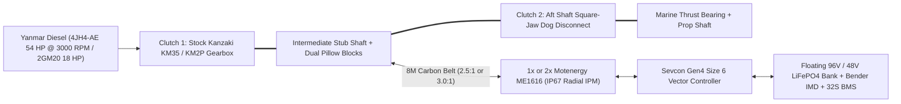

# FluxShaft

**Marine 4-Mode Parallel-Hybrid Propulsion, Diesel-Excess Generation & Under-Sail Hydro-Regeneration (`30+ ft` `48 V` & `40+ ft` `96 V` Shaft-Drive Sailboats)**

`flux-shaft` (**FluxShaft** — combining *Magnetic Flux* [axial-flux PMSM and radial-flux IPM electric machines] and *Propeller Shaft*) is a mechanical, electrical, and control-systems project for converting **`30+ ft` (`48 V`, e.g., Hunter 326 / Hunter 35)** and **`40+ ft` (`96 V`, e.g., 2009 Beneteau Oceanis 40)** auxiliary cruising sailboats into **4-mode parallel hybrids** while retaining the stock diesel engine and mechanical marine transmission.

---

## Why FluxShaft?

A conventional belt-on-prop-shaft parallel hybrid cannot operate as a stationary generator at anchor because shifting the diesel transmission into gear spins the propeller. Conversely, commercial flywheel-sandwich hybrid modules (`Transfluid HM560`, `$10k–$14k`) must back-drive the marine gearbox in Forward gear during sailing regeneration—which causes mechanical cone-clutch transmissions (`Kanzaki KM35` / `KM2P`) to slip or pop out of gear.

**FluxShaft** solves both problems by using the **existing Kanzaki gearbox as `Clutch 1`** and placing a liquid-cooled **`Motenergy ME1616` (Radial IPM)** or **`ME1304` (Axial PMSM)** on a short **intermediate stub shaft** ahead of an **aft square-jaw shaft disconnect (`Clutch 2`)** and thrust bearing:

1. **Mode 1 — Stationary Anchor / Idle Genset (`6.5–10.5 kW DC`, Propeller Stopped):** Disengage `Clutch 2` and shift the `KM35` (`Clutch 1`) into Forward at `1,300–1,800 RPM` to recharge batteries at anchor with the propeller locked out.
2. **Mode 2 — Silent Pure Electric Propulsion (`9–14 kW` Cont. / `35–54 kW` Peak on `1 × ME1616`; `25–38.5 kW` Cont. on `2 × ME1616`):** Diesel off, `KM35` in Neutral (sanctioned freewheel state per Yanmar `MSA08-003`), `Clutch 2` engaged.
3. **Mode 3 — Underway Diesel "Golden Zone" Charging (`9.1–12.1 kW DC` @ `2,000–2,200 RPM`) or Hybrid Boost:** At `2,000–2,200 RPM` on the `Yanmar 4JH4-AE` (`3,000 RPM` rated, `126 N·m` flat torque curve), the propeller only absorbs `11–15 kW`, leaving `11–14 kW` of unused diesel capacity. `FluxShaft` harvests **`~10.5 kWh` of electricity per hour of motoring** while loading the diesel into its clean `75%` BSFC sweet spot.
4. **Mode 4 — Under-Sail Hydrogeneration (`200 W – 1,800 W`):** Diesel off (`KM35` in Neutral), `Clutch 2` engaged; active sine/cosine vector braking harvests hydro-kinetic energy under sail.

---

## System Architecture

---

## Reference Vessel Tiers (From `10 ft` Catamaran Tender to `40+ ft` Offshore Cruiser)

| Tier | Reference Vessel(s) | Voltage & Standard | Motor & Controller Spec | Cont. / Peak Shaft Power & Pushing Force | Complete DIY Cost (incl. `LiFePO4` Bank) |
| :--- | :--- | :--- | :--- | :--- | :--- |
| **Tier 0 (`10 ft` Tender)** | `True Kit Navigator 300 / Discovery 330` (`31–36 kg` inflatable catamaran) | **`48 V DC`** (`16S 100 Ah` `5.12 kWh` portable box, **ABYC E-11**) | `1 × ME1304` (axial-flux pancake, `15.9 kg`) + `Sevcon Gen4 Size 4` on `2.08:1` outboard leg | **`6.8 kW` (`9.2 HP`) cont.** (`185–212 lbf` thrust, `15.5 kn`) / **`13.5 kW` (`18 HP`) peak** (`295–345 lbf`, `19 kn`) | **`~$2,650`** *(incl. `5.12 kWh` pack)* |
| **Tier 1 (`30+ ft` Cruiser)** | `Hunter 326` (`8,300 lb`) / `Hunter 35` (`12,500 lb`) | **`48 V DC`** (`16S 280 Ah` `14.3 kWh`, inside **ABYC E-11 `<60 V`**) | `1 × ME1616` + `1 × Sevcon Gen4 Size 6 (48V)` @ `2.2:1–2.5:1` | **`10.2 kW` cont.** (`365 lbf` cruise / `460 lbf` bollard) / **`21 kW` peak** (`620+ lbf`) | **`~$5,890`** *(incl. `14.3 kWh` pack)* |
| **Tier 2A (`40+ ft` Simplicity)** | `Beneteau Oceanis 40` (`18,210 lb`, `Yanmar 4JH4-AE`) | **`96 V DC`** (`32S 280 Ah` `28.6 kWh`, floating bus + **Bender IMD** per **ABYC E-30 / ISO 16315**) | `1 × ME1616` + `1 × Sevcon Gen4 Size 6 (80/96V)` @ `2.5:1–3.0:1` | **`10.5–13.7 kW` cont.** (`372–447 lbf` cruise / `426–512 lbf` bollard) / **`35–54 kW` peak** (`1,065–1,280 lbf`) | **`~$8,660`** *(incl. `28.6 kWh` pack)* |
| **Tier 2B (`40+ ft` Full Power)** | `Beneteau Oceanis 40` (`18,210 lb`, `Yanmar 4JH4-AE`) | **`96 V DC`** (`32S 280 Ah` `28.6 kWh`, floating bus + **Bender IMD**) | `2 × ME1616` + `2 × Sevcon Gen4 Size 6 (80/96V)` @ `2.5:1–3.0:1` | **`25.4–38.5 kW` cont.** (`745–888 lbf` cruise / `853–1,017 lbf` bollard = 100% diesel match!) | **`~$12,180`** *(incl. `28.6 kWh` pack)* |

---

## Repository Contents

* **[`parallel-hybrid-propulsion-regen-guide.md`](parallel-hybrid-propulsion-regen-guide.md)** — Complete engineering guide covering the 4-mode dual-clutch architecture, `10 ft` (`48 V` `ME1304` dinghy), `30+ ft` (`48 V`), and `40+ ft` (`96 V`) vessel sizing, first-principles comparison of axial-flux SPM (`ME1304`) vs. radial-flux IPM (`ME1616`), `Yanmar 4JH4-AE` (`3,000 RPM`) reduction-ratio and `2,000–2,200 RPM` charging tables, **pushing force (`lbf` / `kgf` / `N`) vs. electrical energy consumption (`kW` / `Wh/nm`) curves**, hydro-regeneration propeller trade-offs, `ABYC E-30 / ISO 16315:2026` floating-bus safety, and BOM/cost breakdowns.

---

## Development Roadmap

- [x] **Phase 0: Drivetrain Physics, Motor Topology & 4-Mode Architecture Specification**
  - Characterize `30+ ft` (`18–28 HP`, `48 V`) and `40+ ft` (`Yanmar 4JH4-AE` `39.6 kW` @ `3,000 RPM`, `126 N·m` flat torque curve, `Kanzaki KM35P/A2` `2.36 / 2.61` and `2.33 / 2.64`, `96 V`) reference drivetrains.
  - Compare `1 × ME1616`, `2 × ME1616`, and `2 × ME1304` across `2.0:1–3.5:1` ratios and `2,000–3,000 RPM` diesel charging curves.
  - Define the 2-clutch (`KM35` + aft shaft dog clutch) architecture enabling stationary anchor generation with the propeller stopped.
- [ ] **Phase 1: Shaft-Alley CAD Packaging (`30+ ft` & `40+ ft` Reference Envelopes)**
  - Verify `KM35` / `KM2P` shaft-alley envelopes and radial clearance for `70T` (`178 mm`) vs. `84T` (`214 mm`) `8M` timing pulleys.
  - Generate parametric `CadQuery` / `OpenSCAD` models (`STEP` / `DXF`) for the bridge frame, intermediate stub shaft, pillow blocks, `Clutch 2` square-jaw dog sleeve, and aft thrust bulkhead.
  - Generate parametric `CadQuery` / `OpenSCAD` models (`STEP` / `DXF`) for the bridge frame, `1.25"` intermediate stub shaft, pillow blocks, `Clutch 2` square-jaw dog sleeve, and aft thrust bulkhead.
- [ ] **Phase 2: Bench Dyno & Controller Characterization (`ME1616` + `Sevcon Gen4 Size 6`)**
  - Bench-test `Motenergy ME1616` + `Sevcon Gen4` sin/cos encoder phasing, `KTY84-130` thermal protection, 4-quadrant throttle/regen mapping, and `BMS` high-cell (`3.50 V/cell`) automatic regen current ramp-down.
- [ ] **Phase 3: On-Vessel Installation & Sea Trials**
  - Install bridge frame, pillow blocks, `Gates PolyChain GT Carbon 8M` drive, floating `96 V` `LiFePO4` bank + `Bender IMD`, and integrate waste-heat glycol loop with `PhaseBallast` / `XeroDorade`.
