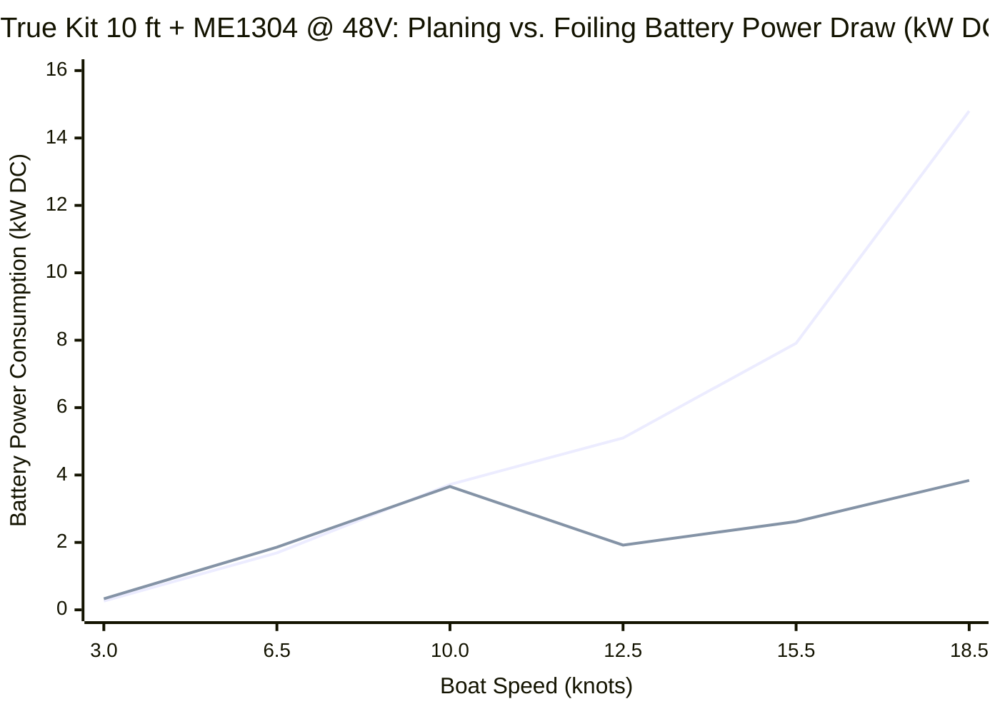
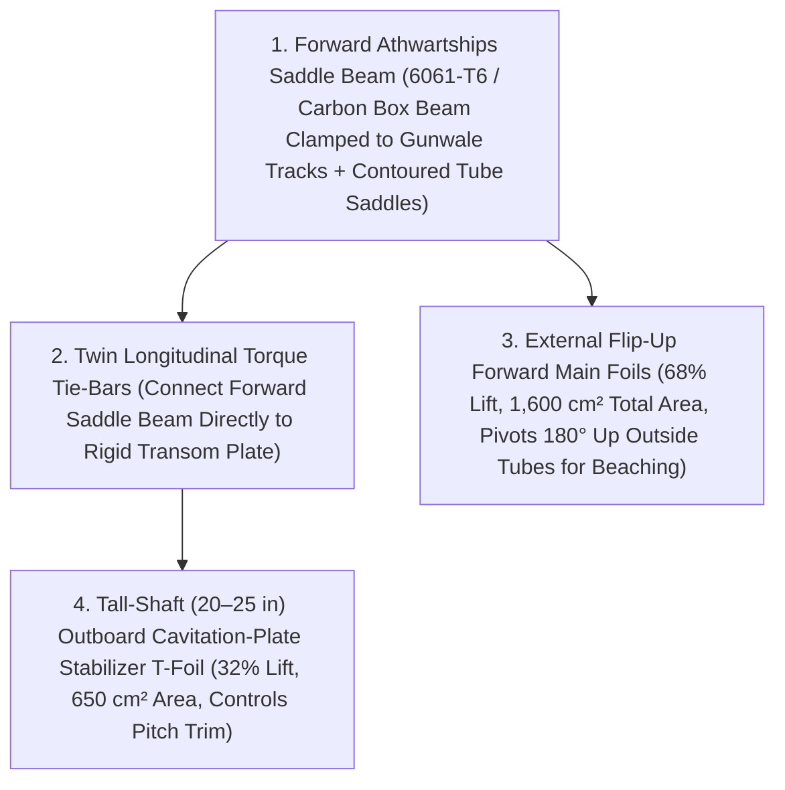

# `48 V` Electric & Foiling Catamaran Dinghy Guide (`True Kit 10 ft` + `Motenergy ME1304`)

A standalone engineering guide for converting an ultralight **`10 ft` (`3.0–3.3 m`) inflatable tunnel-catamaran tender (`True Kit Navigator 300` / `Discovery 330`)** into a high-output **`48 V` (`51.2 V` nominal) electric tender** powered by a **`Motenergy ME1304` axial-flux PMSM**—supporting three modular configurations:
1. **Standard Planing Electric Outboard (`15"` Short-Shaft Leg):** `6.8 kW` (`9.2 HP`) continuous / `13.5 kW` (`18.1 HP`) peak, lighter than a stock `6 HP` 4-stroke gas outboard.
2. **Emergency Yacht Tugboat Mode (`Kort 19A` Nozzle):** `+20% to +25%` static bollard pull (`212 lbf` cont. / `345 lbf` peak) capable of hip-towing a `30–40 ft` sailboat into a slip at `3.0–3.5 knots`.
3. **Tall-Shaft (`20"`–`25"`) Outboard + Externally Mounted Hydrofoil Set:** Lifts the inflatable sponsons `6"`–`9"` clear of the water at `10 knots`, cutting power draw at `15.5 knots` by **`67%`** (`2.62 kW` vs. `7.91 kW`) and **tripling high-speed range (`30.3 nm` on `5.12 kWh`)**.

---

## 1. Why `True Kit 10 ft` + Axial-Flux `Motenergy ME1304 @ 48 V`?

While the heavier radial-IPM **`ME1616` (`24 kg` / `53 lb`)** wins inside a yacht's engine room (see [`parallel-hybrid-propulsion-regen-guide.md`](parallel-hybrid-propulsion-regen-guide.md)), the **axial-flux `Motenergy ME1304` (`15.9 kg` / `35 lb`, flat `Ø223 × 167 mm` pancake)** is the ideal electric outboard powerhead for an ultralight inflatable catamaran transom:

| Parameter | Specification |
| :--- | :--- |
| **Reference Hull** | `True Kit Navigator 300` (`3.0 m` / `9'10"`, `31 kg` / `68 lb`, `10 HP` max) or `Discovery 330` (`3.3 m` / `10'9"`, `36 kg` / `79 lb`, `15 HP` max) |
| **Hull Capacity** | `500 kg` (`1,100 lb`) |
| **Electric Powerhead** | `1 × Motenergy ME1304` (`15.9 kg`, IP65 liquid-cooled axial-gap PMSM, `22–25 N·m` cont. / `90 N·m` peak, sin/cos encoder) |
| **Motor Controller** | `1 × Sevcon Gen4 Size 4 (48 V, 350 A)` or `Curtis 1236SE-5421` on a water-cooled aluminum baseplate |
| **Donor Outboard Lower Leg** | `Mercury / Tohatsu 6–9.9 HP` lower unit (`2.08:1` bevel gear + integrated raw-water impeller feeding the `ME1304` cooling jacket) |
| **Complete Outboard Weight** | **`~24.5 kg` (`54 lb`)** (`15"` short shaft) or **`~26.0 kg` (`57 lb`)** (`20"`–`25"` tall shaft) — *lighter than a `26 kg` `6 HP` or `38 kg` `9.9 HP` 4-stroke gas outboard* |
| **Output @ `48 V` (`51.2 V` Nom.)** | **`6.8 kW` (`9.2 HP`) continuous** (`154 A` DC) / **`13.5 kW` (`18.1 HP`) peak** (`307 A` DC, `1–2 min` burst) |
| **Portable Battery Pack** | Waterproof `IP67` `48 V 100 Ah` **`5.12 kWh`** `16S LiFePO4` case (`~36 kg` / `79 lb`), positioned forward in the bow to trim the catamaran level |

### Key Synergies
* **Zero Planing Hump:** Unlike a V-hull or flat-bottom inflatable that pushes a steep bow wave before climbing onto plane, the `True Kit`'s narrow dual tunnel-catamaran sponsons accelerate smoothly from `6 kn` to `15+ kn` (`17+ mph`) using **`35%–45%` less power**.
* **Unified `48 V` Mothership Charging:** The portable `16S LiFePO4` dinghy pack stays inside **ABYC E-11 (`<60 V DC`)** and charges directly from the mothership's `48 V` bus, a `96 V → 48 V` isolated converter, or the yacht's solar MPPT array.
* **Emergency Yacht Tugboat Mode (`Kort 19A` Nozzle):** Fitting an `8.5" × 8"` propeller inside a **Kort 19A accelerating duct** boosts static bollard thrust by **`+20% to +25%`** (up to **`212 lbf` continuous / `345 lbf` peak**)—allowing the `10 ft` dinghy lashed alongside the yacht's quarter to hip-tow a `30–40 ft` sailboat into a slip at `3.0–3.5 knots`.

---

## 2. Standard Planing Configuration (`15"` Short-Shaft Leg, Open Prop vs. `Kort 19A`)

*(1–2 adults, `~220 kg` / `485 lb` total displacement; `5.12 kWh` battery pack @ `51.2 V` nominal; `86%` combined battery-to-prop-shaft efficiency)*

| Operating Regime (`~220 kg` Total) | Speed (`knots` / `mph`) | **Pushing Force (Open `8.5"` Prop)** | **Pushing Force (w/ `Kort 19A` Nozzle)** | Shaft Power (`HP`) | **Battery Power Draw (`DC kW` & `Amps @ 51.2 V`)** | **Energy per Mile (`Wh/nm`)** | **Runtime & Range (`5.12 kWh` Pack)** |
| :--- | :---: | :--- | :--- | :---: | :--- | :---: | :---: |
| **1. Trolling / No-Wake Harbor** | **`3.0 kn`** (`3.5 mph`) | **`24 lbf`** (`11 kgf` / `107 N`) | **`30 lbf`** (`14 kgf` / `133 N`) | `0.22 kW` (`0.3 HP`) | **`0.26 kW`** (`5.0 A`) | **`85 Wh/nm`** | **`20.0 hrs` (`60.0 nm`)** |
| **2. Displacement Eco Cruise** | **`4.5 kn`** (`5.2 mph`) | **`45 lbf`** (`20 kgf` / `200 N`) | **`56 lbf`** (`25 kgf` / `249 N`) | `0.58 kW` (`0.8 HP`) | **`0.67 kW`** (`13.2 A`) | **`150 Wh/nm`** | **`7.6 hrs` (`34.2 nm`)** |
| **3. Fast Displacement / Semi-Plane** | **`6.5 kn`** (`7.5 mph`) | **`78 lbf`** (`35 kgf` / `347 N`) | **`96 lbf`** (`44 kgf` / `427 N`) | `1.45 kW` (`1.9 HP`) | **`1.69 kW`** (`33.0 A`) | **`259 Wh/nm`** | **`3.0 hrs` (`19.7 nm`)** |
| **4. Catamaran Planing Cruise** | **`10.0 kn`** (`11.5 mph`) | **`118 lbf`** (`54 kgf` / `525 N`) | **`142 lbf`** (`64 kgf` / `632 N`) | `3.20 kW` (`4.3 HP`) | **`3.72 kW`** (`72.7 A`) | **`372 Wh/nm`** | **`1.4 hrs` (`13.8 nm`)** |
| **5. Fast Planing (`6 HP` Gas Equiv.)** | **`13.0 kn`** (`15.0 mph`) | **`145 lbf`** (`66 kgf` / `645 N`) | **`170 lbf`** (`77 kgf` / `756 N`) | `4.60 kW` (`6.2 HP`) | **`5.35 kW`** (`104 A`) | **`411 Wh/nm`** | **`1.0 hr` (`12.4 nm`)** |
| **6. `ME1304` @ `48 V` Cont. Max** | **`15.5 kn`** (`17.8 mph`) | **`185 lbf`** (`84 kgf` / `823 N`) | **`212 lbf`** (`96 kgf` / `943 N`) | `6.80 kW` (`9.2 HP`) | **`7.91 kW`** (`154 A`) | **`510 Wh/nm`** | **`0.65 hrs` (`10.0 nm`)** |
| **7. `ME1304` Peak Hole-Shot / Tow** | **`19.0 kn`** (`21.9 mph`) | **`295 lbf`** (`134 kgf` / `1,312 N`) | **`345 lbf`** (`156 kgf` / `1,535 N`) | `13.50 kW` (`18.1 HP`) | **`15.70 kW`** (`307 A`) | **`826 Wh/nm`** | `1–2 min` burst |

---

## 3. Tall-Shaft (`20"`–`25"`) Outboard + Externally Mounted Hydrofoil Set

Planing at `15.5 knots` on the inflatable sponsons draws **`7.91 kW` (`510 Wh/nm`, `10.0 nm` range)**. Lifting the `True Kit 10 ft` catamaran **`150–200 mm` (`6"–8"`) clear of the water on an externally mounted hydrofoil set** cuts hydrodynamic drag at `15.5 knots` by **`75%`** (from `185 lbf` down to **`46 lbf`**)—dropping battery draw to **`2.62 kW` (`169 Wh/nm`)** and **tripling high-speed range on the `5.12 kWh` battery from `10.0 nm` to `30.3 nm`**.

### A. Planing vs. Foiling Power Draw Across Speed

*(Upper Line = Standard Planing Catamaran `kW DC`; Lower Line = Tall-Shaft Outboard + External Hydrofoils `kW DC`, dropping sharply after `10.0 kn` lift-off)*

### B. Why a Tall (`20"` Long / `25"` Extra-Long) Outboard Shaft is Mandatory for Foiling
* A standard `15"` (`381 mm`) short-shaft outboard places the propeller just `25–50 mm` below the bottom of the inflatable tubes; the moment the hull lifts onto hydrofoils, a `15"` prop ventilates in air.
* **Tall-Shaft + Sliding Jack-Plate Solution:** Mount the `ME1304 @ 48 V` powerhead onto a **`20"` (`508 mm` Long) or `25"` (`635 mm` SailPower Extra-Long) donor lower leg** fitted to a **vertical sliding/kick-up transom jack plate**:
  * **Foiling Mode (Down):** Submerges the propeller and aft stabilizer T-foil **`220–300 mm` (`9"–12"`) below the inflatable sponsons**, allowing **`150–220 mm` (`6"–9"`) of clean air gap** above harbor chop without ventilation.
  * **Shallow / Beach-Landing Mode (Up):** Slides/tilts up so the `True Kit` preserves its signature `6"` beaching draft.

### C. External Clamp-On Exoskeleton & Flip-Up Hydrofoil Architecture
Because a soft inflatable catamaran cannot absorb concentrated hydrofoil bending moments through glued PVC/Valmex seams alone, the hydrofoil set mounts to a **rigid, quick-detach external `6061-T6` aluminum / carbon exoskeleton**:

* **Forward Main Foil Options (`68%` of Weight, Positioned `100–150 mm` Ahead of Loaded `LCG`):**
  * **Option 1 — Self-Stabilizing Surface-Piercing Dihedral `V-Foils` (`32°` Dihedral, Zero Moving Parts):** External port and starboard carbon/aluminum struts drop outside the tubes and angle inward at `32°`. As the hull rises, more of the angled wing emerges from the water, passively reducing submerged area ($S_{\text{wet}}(h)$) until lift equals weight ($L = W$). Inherently stable in roll, pitch, and ride height with zero electronics or moving flaps.
  * **Option 2 — High-Aspect Submerged Carbon `T-Foils` (`AR = 7.6`, `1,600 cm²` / `0.16 m²`, `Eppler 817` section) with Bow Surface-Skimming Wands:** Twin mechanical bow wands (`Moth`-style) modulate trailing-edge flaps on the port and starboard T-foils, achieving higher lift-to-drag ($L/D \approx 12\text{–}15$) and a smoother ride across steep wakes.
* **Aft Stabilizer Foil (`32%` of Weight, `650 cm²` / `0.065 m²`):**
  * Bolts directly to the reinforced anti-ventilation plate of the **tall `20"–25"` outboard lower unit** just above the propeller (`9" × 12"` high-pitch 3-blade stainless prop for `12–23 kn` foiling).
* **10-Second Flip-Up Beaching:** Both external port and starboard foil struts lock into spring-loaded over-center detents on the cross-beam ends and **flip `180°` straight up alongside the tubes** (like `True Kit`'s flip-up beach wheels) when approaching a beach or yacht davits.

### D. Foiling `True Kit 10 ft` — Pushing Force vs. Energy Consumption Table
*(All-up flying mass `235 kg` / `518 lb` [`1–2 crew + 36 kg 5.12 kWh pack + 26 kg tall outboard + 14 kg foil kit`]; takeoff speed **`9.7–10.2 knots`**)*

| Operating Regime (`235 kg` / `518 lb` Flying Weight) | Speed (`knots` / `mph`) | **Hydrodynamic Drag / Required Thrust** | Shaft Power (`HP`) | **Battery Power Draw (`DC kW` & `Amps @ 51.2 V`)** | **Energy per Mile (`Wh/nm`)** | **Runtime & Range (`5.12 kWh` Pack)** | Comparison vs. Non-Foiling Catamaran |
| :--- | :---: | :--- | :---: | :--- | :---: | :---: | :--- |
| **1. Displacement Harbor (Foils Down)** | **`3.0 kn`** (`3.5 mph`) | **`28 lbf`** (`13 kgf` / `125 N`) | `0.28 kW` (`0.4 HP`) | **`0.33 kW`** (`6.4 A`) | **`110 Wh/nm`** | **`15.5 hrs` (`46.5 nm`)** | Flip foils up in `3 kn` zones for `85 Wh/nm` |
| **2. Pre-Takeoff Catamaran Glide** | **`6.5 kn`** (`7.5 mph`) | **`85 lbf`** (`39 kgf` / `378 N`) | `1.60 kW` (`2.1 HP`) | **`1.86 kW`** (`36.3 A`) | **`286 Wh/nm`** | **`2.8 hrs` (`17.9 nm`)** | Foils generate `~40%` lift, unweighting sponsons |
| **3. Foil Take-Off Transition (`3-sec` Hump)** | **`10.0 kn`** (`11.5 mph`) | **`115 lbf`** (`52 kgf` / `512 N`) | `3.15 kW` (`4.2 HP`) | **`3.66 kW`** (`71.5 A`) | **`366 Wh/nm`** | `3–4 sec` transition | Sponsons lift completely clear of water at `10.0 kn` |
| **4. Eco Foiling Cruise (`6"` Clear!)** | **`12.5 kn`** (`14.4 mph`) | **`42 lbf`** (`19 kgf` / `187 N`) | `1.65 kW` (`2.2 HP`) | **`1.92 kW`** (`37.5 A`) | **`154 Wh/nm`** | **`2.7 hrs` (`33.3 nm`)** | **`64%` less power** & **`2.7×` range** vs planing |
| **5. Standard Foiling Cruise (Sweet Spot)** | **`15.5 kn`** (`17.8 mph`) | **`46 lbf`** (`21 kgf` / `205 N`) | `2.25 kW` (`3.0 HP`) | **`2.62 kW`** (`51.2 A`) | **`169 Wh/nm`** | **`2.0 hrs` (`30.3 nm`)** | **`67%` less power (`2.6 kW` vs `7.9 kW`) & `3.0×` range (`30.3 nm` vs `10.0 nm`)!** |
| **6. Fast Foiling Cruise** | **`18.5 kn`** (`21.3 mph`) | **`55 lbf`** (`25 kgf` / `245 N`) | `3.30 kW` (`4.4 HP`) | **`3.84 kW`** (`75.0 A`) | **`208 Wh/nm`** | **`1.3 hrs` (`24.7 nm`)** | Uses less power at `18.5 kn` than non-foiling at `10.5 kn` |
| **7. Max Continuous Foiling (`ME1304` Cont.)** | **`22.5 kn`** (`25.9 mph`) | **`82 lbf`** (`37 kgf` / `365 N`) | `6.20 kW` (`8.3 HP`) | **`7.21 kW`** (`141 A`) | **`320 Wh/nm`** | **`0.7 hrs` (`16.0 nm`)** | **`+7.0 knots` faster** top continuous speed |

---

## 4. Complete Bill of Materials (`Planing` vs. `Foiling` Conversion)

| Subsystem | **Standard Planing Kit (`15"` Short-Shaft)** | **Foiling Kit (`20"`–`25"` Tall-Shaft + External Hydrofoils)** |
| :--- | :--- | :--- |
| **Electric Motor** | `1 × Motenergy ME1304` liquid-cooled axial-flux PMSM (`$965`) | `1 × Motenergy ME1304` liquid-cooled axial-flux PMSM (`$965`) |
| **Vector Controller + Cooling Plate** | `1 × Sevcon Gen4 Size 4 (48V, 350A)` or `Curtis 1236SE` (`$750`) | `1 × Sevcon Gen4 Size 4 (48V, 350A)` or `Curtis 1236SE` (`$750`) |
| **Donor Outboard Lower Leg & Adapter** | `15"` `Mercury / Tohatsu 6–9.9 HP` leg + CNC `6061-T6` plate + coupler (`$350`) | **`20"`–`25"` SailPower tall leg** + CNC plate + **vertical sliding jack plate** (`$500`) |
| **External Hydrofoil Exoskeleton & Wings** | *N/A* *(Optional `Kort 19A` duct for tugboat mode: `+$150`)* | `1,600 cm²` carbon front wings + `650 cm²` aft stabilizer wing + `6061-T6` saddle beam, flip-up brackets & transom tie-bars (`$800 – $1,300`) |
| **Portable `5.12 kWh` `48 V` `LiFePO4` Pack** | `IP67` case + `16S EVE LF105 (100 Ah)` + `200 A JK BMS` + `Anderson SB175` (`$585`) | `IP67` case + `16S EVE LF105 (100 Ah)` + `200 A JK BMS` + `Anderson SB175` (`$585`) |
| **Complete Conversion Total (Excl. Hull)** | **`~$2,650`** *(vs. `$6,500–$9,000` `Torqeedo / ePropulsion 6.0`)* | **`~$3,600 – $4,100`** *(Full `22.5 kn` / `30 nm` foiling electric tender!)* |
