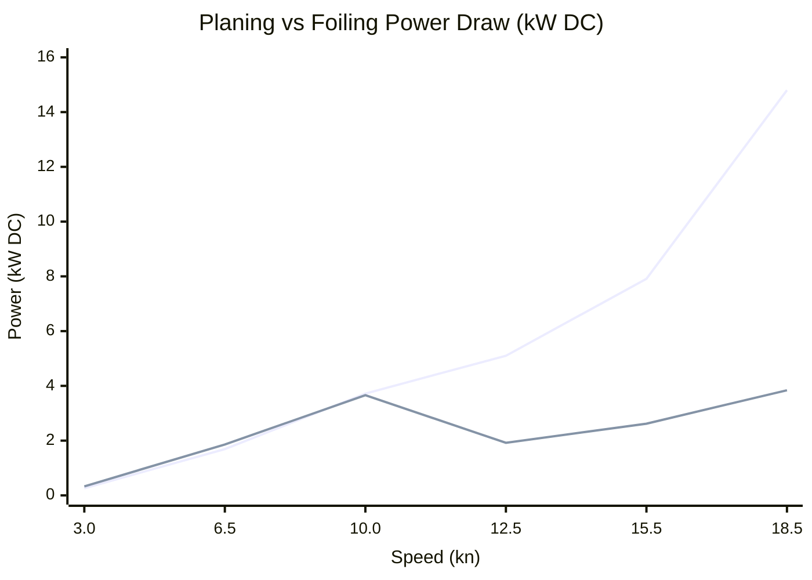
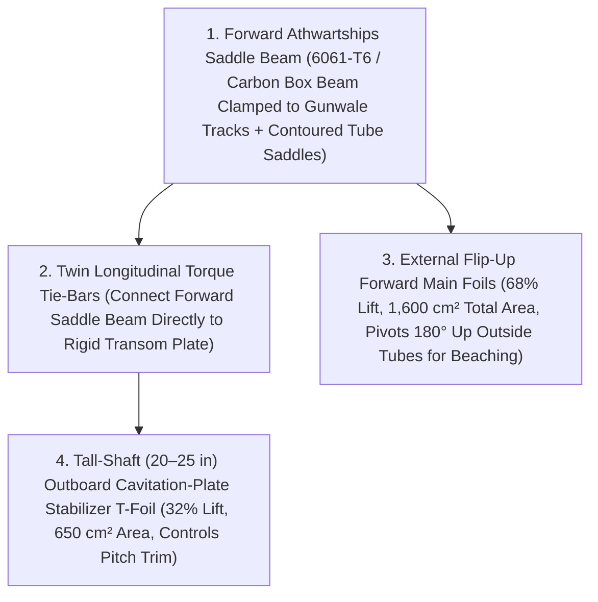
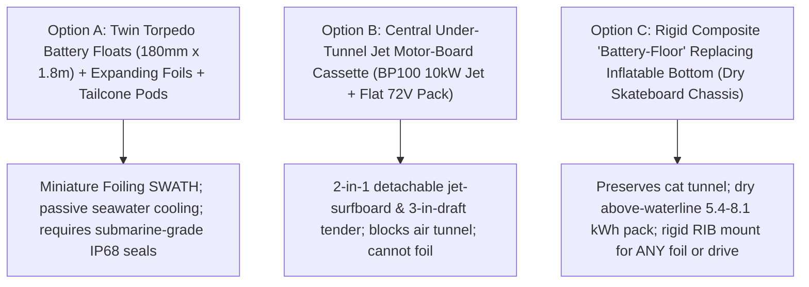

# `48 V` Electric & Foiling Catamaran Dinghy Guide (`True Kit 10 ft` + `Motenergy ME1304`)

A standalone engineering guide for converting an ultralight **`10 ft` (`3.0–3.3 m`) inflatable tunnel-catamaran tender (`True Kit Navigator 300` / `Discovery 330`)** into a high-output electric tender—comparing propulsion options (`Motenergy ME1304` outboard, `APISQUEEN U30` `2 kW` all-metal ducted thrusters, `Flipsky 65161` e-foil pods, and `APISQUEEN BP100` `10 kW` pump-jet) and integrated custom-battery hull architectures:
1. **Standard Planing Electric Outboard (`15"` Short-Shaft `ME1304 @ 48 V`):** `6.8 kW` (`9.2 HP`) continuous / `13.5 kW` (`18.1 HP`) peak, lighter than a stock `6 HP` 4-stroke gas outboard.
2. **Emergency Yacht Tugboat Mode (`Kort 19A` Nozzle):** `+20% to +25%` static bollard pull (`212 lbf` cont. / `345 lbf` peak) capable of hip-towing a `30–40 ft` sailboat into a slip at `3.0–3.5 knots`.
3. **Tall-Shaft (`20"`–`25"`) Outboard + Externally Mounted Hydrofoil Set:** Lifts the inflatable sponsons `6"`–`9"` clear of the water at `10 knots`, cutting power draw at `15.5 knots` by **`67%`** (`2.62 kW` vs. `7.91 kW`) and **tripling high-speed range (`30.3 nm` on `5.12 kWh`)**.
4. **Integrated Custom-Battery & Alternative Hull Architectures:** Comparing **Twin Torpedo SWATH Floats with Expanding Foils**, a **Central Under-Tunnel `APISQUEEN BP100` `10 kW` Jet Motor-Board**, and a **Rigid Composite "Battery-Floor" Skateboard Chassis** replacing the inflatable drop-stitch bottom (`5.38–8.06 kWh` flat `EVE LF105` pack).

---

## 1. Why `True Kit 10 ft` + Axial-Flux `Motenergy ME1304 @ 48 V`?

While the heavier radial-IPM **`ME1616` (`24 kg` / `53 lb`)** wins inside a yacht's engine room (see [`parallel-hybrid-propulsion-regen-guide.md`](parallel-hybrid-propulsion-regen-guide.md)), the **axial-flux `Motenergy ME1304` (`15.9 kg` / `35 lb`, flat `Ø223 × 167 mm` pancake)** is the ideal electric outboard powerhead for an ultralight inflatable catamaran transom:

| Parameter | Specification |
| :--- | :--- |
| **Reference Hull** | `True Kit Navigator 300` (`3.0 m` / `9'10"`, `31 kg` / `68 lb`, `10 HP` max) or `Discovery 330` (`3.3 m` / `10'9"`, `36 kg` / `79 lb`, `15 HP` max) |
| **Hull Capacity** | `500 kg` (`1,100 lb`) |
| **Electric Powerhead** | `1 × Motenergy ME1304` (`15.9 kg`, IP65 liquid-cooled axial-gap PMSM, `22–25 N·m` cont. / `90 N·m` peak, sin/cos encoder) |
| **Motor Controller** | `1 × Sevcon Gen4 Size 4 (48 V, 350 A)` or `Curtis 1236SE-5421` on a water-cooled aluminum baseplate |
| **Donor Outboard Lower Leg** | `Mercury / Tohatsu 6–9.9 HP` lower unit (`2.08:1` bevel gear + integrated raw-water impeller feeding the `ME1304` cooling jacket) |
| **Complete Outboard Weight** | **`~24.5 kg` (`54 lb`)** (`15"` short shaft) or **`~26.0 kg` (`57 lb`)** (`20"`–`25"` tall shaft) — *lighter than a `26 kg` `6 HP` or `38 kg` `9.9 HP` 4-stroke gas outboard* |
| **Output @ `48 V` (`51.2 V` Nom.)** | **`6.8 kW` (`9.2 HP`) continuous** (`154 A` DC) / **`13.5 kW` (`18.1 HP`) peak** (`307 A` DC, `1–2 min` burst) |
| **Portable Battery Pack** | Waterproof `IP67` `48 V 100 Ah` **`5.12 kWh`** `16S LiFePO4` case (`~36 kg` / `79 lb`), positioned forward in the bow to trim the catamaran level |

### Key Synergies
* **Zero Planing Hump:** Unlike a V-hull or flat-bottom inflatable that pushes a steep bow wave before climbing onto plane, the `True Kit`'s narrow dual tunnel-catamaran sponsons accelerate smoothly from `6 kn` to `15+ kn` (`17+ mph`) using **`35%–45%` less power**.
* **Unified `48 V` Mothership Charging:** The portable `16S LiFePO4` dinghy pack stays inside **ABYC E-11 (`<60 V DC`)** and charges directly from the mothership's `48 V` bus, a `96 V → 48 V` isolated converter, or the yacht's solar MPPT array.
* **Emergency Yacht Tugboat Mode (`Kort 19A` Nozzle):** Fitting an `8.5" × 8"` propeller inside a **Kort 19A accelerating duct** boosts static bollard thrust by **`+20% to +25%`** (up to **`212 lbf` continuous / `345 lbf` peak**)—allowing the `10 ft` dinghy lashed alongside the yacht's quarter to hip-tow a `30–40 ft` sailboat into a slip at `3.0–3.5 knots`.

---

## 2. Standard Planing Configuration (`15"` Short-Shaft Leg, Open Prop vs. `Kort 19A`)

*(1–2 adults, `~220 kg` / `485 lb` total displacement; `5.12 kWh` battery pack @ `51.2 V` nominal; `86%` combined battery-to-prop-shaft efficiency)*

| Operating Regime (`~220 kg` Total) | Speed (`knots` / `mph`) | **Pushing Force (Open `8.5"` Prop)** | **Pushing Force (w/ `Kort 19A` Nozzle)** | Shaft Power (`HP`) | **Battery Power Draw (`DC kW` & `Amps @ 51.2 V`)** | **Energy per Mile (`Wh/nm`)** | **Runtime & Range (`5.12 kWh` Pack)** |
| :--- | :---: | :--- | :--- | :---: | :--- | :---: | :---: |
| **1. Trolling / No-Wake Harbor** | **`3.0 kn`** (`3.5 mph`) | **`24 lbf`** (`11 kgf` / `107 N`) | **`30 lbf`** (`14 kgf` / `133 N`) | `0.22 kW` (`0.3 HP`) | **`0.26 kW`** (`5.0 A`) | **`85 Wh/nm`** | **`20.0 hrs` (`60.0 nm`)** |
| **2. Displacement Eco Cruise** | **`4.5 kn`** (`5.2 mph`) | **`45 lbf`** (`20 kgf` / `200 N`) | **`56 lbf`** (`25 kgf` / `249 N`) | `0.58 kW` (`0.8 HP`) | **`0.67 kW`** (`13.2 A`) | **`150 Wh/nm`** | **`7.6 hrs` (`34.2 nm`)** |
| **3. Fast Displacement / Semi-Plane** | **`6.5 kn`** (`7.5 mph`) | **`78 lbf`** (`35 kgf` / `347 N`) | **`96 lbf`** (`44 kgf` / `427 N`) | `1.45 kW` (`1.9 HP`) | **`1.69 kW`** (`33.0 A`) | **`259 Wh/nm`** | **`3.0 hrs` (`19.7 nm`)** |
| **4. Catamaran Planing Cruise** | **`10.0 kn`** (`11.5 mph`) | **`118 lbf`** (`54 kgf` / `525 N`) | **`142 lbf`** (`64 kgf` / `632 N`) | `3.20 kW` (`4.3 HP`) | **`3.72 kW`** (`72.7 A`) | **`372 Wh/nm`** | **`1.4 hrs` (`13.8 nm`)** |
| **5. Fast Planing (`6 HP` Gas Equiv.)** | **`13.0 kn`** (`15.0 mph`) | **`145 lbf`** (`66 kgf` / `645 N`) | **`170 lbf`** (`77 kgf` / `756 N`) | `4.60 kW` (`6.2 HP`) | **`5.35 kW`** (`104 A`) | **`411 Wh/nm`** | **`1.0 hr` (`12.4 nm`)** |
| **6. `ME1304` @ `48 V` Cont. Max** | **`15.5 kn`** (`17.8 mph`) | **`185 lbf`** (`84 kgf` / `823 N`) | **`212 lbf`** (`96 kgf` / `943 N`) | `6.80 kW` (`9.2 HP`) | **`7.91 kW`** (`154 A`) | **`510 Wh/nm`** | **`0.65 hrs` (`10.0 nm`)** |
| **7. `ME1304` Peak Hole-Shot / Tow** | **`19.0 kn`** (`21.9 mph`) | **`295 lbf`** (`134 kgf` / `1,312 N`) | **`345 lbf`** (`156 kgf` / `1,535 N`) | `13.50 kW` (`18.1 HP`) | **`15.70 kW`** (`307 A`) | **`826 Wh/nm`** | `1–2 min` burst |

---

## 3. Tall-Shaft (`20"`–`25"`) Outboard + Externally Mounted Hydrofoil Set

Planing at `15.5 knots` on the inflatable sponsons draws **`7.91 kW` (`510 Wh/nm`, `10.0 nm` range)**. Lifting the `True Kit 10 ft` catamaran **`150–200 mm` (`6"–8"`) clear of the water on an externally mounted hydrofoil set** cuts hydrodynamic drag at `15.5 knots` by **`75%`** (from `185 lbf` down to **`46 lbf`**)—dropping battery draw to **`2.62 kW` (`169 Wh/nm`)** and **tripling high-speed range on the `5.12 kWh` battery from `10.0 nm` to `30.3 nm`**.

### A. Planing vs. Foiling Power Draw Across Speed

*(Upper Line = Standard Planing Catamaran `kW DC`; Lower Line = Tall-Shaft Outboard + External Hydrofoils `kW DC`, dropping sharply after `10.0 kn` lift-off)*

### B. Why a Tall (`20"` Long / `25"` Extra-Long) Outboard Shaft is Mandatory for Foiling
* A standard `15"` (`381 mm`) short-shaft outboard places the propeller just `25–50 mm` below the bottom of the inflatable tubes; the moment the hull lifts onto hydrofoils, a `15"` prop ventilates in air.
* **Tall-Shaft + Sliding Jack-Plate Solution:** Mount the `ME1304 @ 48 V` powerhead onto a **`20"` (`508 mm` Long) or `25"` (`635 mm` SailPower Extra-Long) donor lower leg** fitted to a **vertical sliding/kick-up transom jack plate**:
  * **Foiling Mode (Down):** Submerges the propeller and aft stabilizer T-foil **`220–300 mm` (`9"–12"`) below the inflatable sponsons**, allowing **`150–220 mm` (`6"–9"`) of clean air gap** above harbor chop without ventilation.
  * **Shallow / Beach-Landing Mode (Up):** Slides/tilts up so the `True Kit` preserves its signature `6"` beaching draft.

### C. External Clamp-On Exoskeleton & Flip-Up Hydrofoil Architecture
Because a soft inflatable catamaran cannot absorb concentrated hydrofoil bending moments through glued PVC/Valmex seams alone, the hydrofoil set mounts to a **rigid, quick-detach external `6061-T6` aluminum / carbon exoskeleton**:

* **Forward Main Foil Options (`68%` of Weight, Positioned `100–150 mm` Ahead of Loaded `LCG`):**
  * **Option 1 — Self-Stabilizing Surface-Piercing Dihedral `V-Foils` (`32°` Dihedral, Zero Moving Parts):** External port and starboard carbon/aluminum struts drop outside the tubes and angle inward at `32°`. As the hull rises, more of the angled wing emerges from the water, passively reducing submerged area ($S_{\text{wet}}(h)$) until lift equals weight ($L = W$). Inherently stable in roll, pitch, and ride height with zero electronics or moving flaps.
  * **Option 2 — High-Aspect Submerged Carbon `T-Foils` (`AR = 7.6`, `1,600 cm²` / `0.16 m²`, `Eppler 817` section) with Bow Surface-Skimming Wands:** Twin mechanical bow wands (`Moth`-style) modulate trailing-edge flaps on the port and starboard T-foils, achieving higher lift-to-drag ($L/D \approx 12\text{–}15$) and a smoother ride across steep wakes.
* **Aft Stabilizer Foil (`32%` of Weight, `650 cm²` / `0.065 m²`):**
  * Bolts directly to the reinforced anti-ventilation plate of the **tall `20"–25"` outboard lower unit** just above the propeller (`9" × 12"` high-pitch 3-blade stainless prop for `12–23 kn` foiling).
* **10-Second Flip-Up Beaching:** Both external port and starboard foil struts lock into spring-loaded over-center detents on the cross-beam ends and **flip `180°` straight up alongside the tubes** (like `True Kit`'s flip-up beach wheels) when approaching a beach or yacht davits.

### D. Foiling `True Kit 10 ft` — Pushing Force vs. Energy Consumption Table
*(All-up flying mass `235 kg` / `518 lb` [`1–2 crew + 36 kg 5.12 kWh pack + 26 kg tall outboard + 14 kg foil kit`]; takeoff speed **`9.7–10.2 knots`**)*

| Operating Regime (`235 kg` / `518 lb` Flying Weight) | Speed (`knots` / `mph`) | **Hydrodynamic Drag / Required Thrust** | Shaft Power (`HP`) | **Battery Power Draw (`DC kW` & `Amps @ 51.2 V`)** | **Energy per Mile (`Wh/nm`)** | **Runtime & Range (`5.12 kWh` Pack)** | Comparison vs. Non-Foiling Catamaran |
| :--- | :---: | :--- | :---: | :--- | :---: | :---: | :--- |
| **1. Displacement Harbor (Foils Down)** | **`3.0 kn`** (`3.5 mph`) | **`28 lbf`** (`13 kgf` / `125 N`) | `0.28 kW` (`0.4 HP`) | **`0.33 kW`** (`6.4 A`) | **`110 Wh/nm`** | **`15.5 hrs` (`46.5 nm`)** | Flip foils up in `3 kn` zones for `85 Wh/nm` |
| **2. Pre-Takeoff Catamaran Glide** | **`6.5 kn`** (`7.5 mph`) | **`85 lbf`** (`39 kgf` / `378 N`) | `1.60 kW` (`2.1 HP`) | **`1.86 kW`** (`36.3 A`) | **`286 Wh/nm`** | **`2.8 hrs` (`17.9 nm`)** | Foils generate `~40%` lift, unweighting sponsons |
| **3. Foil Take-Off Transition (`3-sec` Hump)** | **`10.0 kn`** (`11.5 mph`) | **`115 lbf`** (`52 kgf` / `512 N`) | `3.15 kW` (`4.2 HP`) | **`3.66 kW`** (`71.5 A`) | **`366 Wh/nm`** | `3–4 sec` transition | Sponsons lift completely clear of water at `10.0 kn` |
| **4. Eco Foiling Cruise (`6"` Clear!)** | **`12.5 kn`** (`14.4 mph`) | **`42 lbf`** (`19 kgf` / `187 N`) | `1.65 kW` (`2.2 HP`) | **`1.92 kW`** (`37.5 A`) | **`154 Wh/nm`** | **`2.7 hrs` (`33.3 nm`)** | **`64%` less power** & **`2.7×` range** vs planing |
| **5. Standard Foiling Cruise (Sweet Spot)** | **`15.5 kn`** (`17.8 mph`) | **`46 lbf`** (`21 kgf` / `205 N`) | `2.25 kW` (`3.0 HP`) | **`2.62 kW`** (`51.2 A`) | **`169 Wh/nm`** | **`2.0 hrs` (`30.3 nm`)** | **`67%` less power (`2.6 kW` vs `7.9 kW`) & `3.0×` range (`30.3 nm` vs `10.0 nm`)!** |
| **6. Fast Foiling Cruise** | **`18.5 kn`** (`21.3 mph`) | **`55 lbf`** (`25 kgf` / `245 N`) | `3.30 kW` (`4.4 HP`) | **`3.84 kW`** (`75.0 A`) | **`208 Wh/nm`** | **`1.3 hrs` (`24.7 nm`)** | Uses less power at `18.5 kn` than non-foiling at `10.5 kn` |
| **7. Max Continuous Foiling (`ME1304` Cont.)** | **`22.5 kn`** (`25.9 mph`) | **`82 lbf`** (`37 kgf` / `365 N`) | `6.20 kW` (`8.3 HP`) | **`7.21 kW`** (`141 A`) | **`320 Wh/nm`** | **`0.7 hrs` (`16.0 nm`)** | **`+7.0 knots` faster** top continuous speed |

---

## 4. Alternative Propulsion & Integrated Custom-Battery Hull Architectures

Beyond a transom outboard with a portable bow battery box, an inflatable tunnel catamaran (`True Kit 10 ft`) enables **integrated structural battery-and-thruster architectures**—comparing **jet thrusters vs. submerged pods vs. outboards**, and **twin torpedo floats vs. a central motor-board vs. a rigid composite battery-floor**.

### A. Propulsion Comparison: Ducted Thrusters (`APISQUEEN U30`) vs. Submerged Pods (`Flipsky 65161`) vs. Pump-Jet (`BP100`) vs. Outboard (`ME1304`)

| Drive Option | Voltage & Power | Max Static Thrust | **Thrust Efficiency (`lbf/kW`)** | Weight & Cost | Foiling Compatible? | Best Application |
| :--- | :--- | :--- | :---: | :--- | :---: | :--- |
| **`2 × APISQUEEN U30` All-Metal Ducted Thrusters** *(2 kW ea., w/ ESCs)* | **`48 V`** *(12S LiPo / `50.4 V` max; use `15S LiFePO4` or `60 V` VESC for `16S`)*, **`4.0 kW`** (`2 × 2 kW`) | **`132 lbf`** (`60 kgf`, `2 × 30 kgf`) | **`33.0 lbf/kW`** *(Best low-speed bollard eff.!)* | `2 × 2.14 kg` + `2 × 0.5 kg` ESC = **`5.3 kg` total** (`~$1,300` pair) | **Marginal (`1-up` low-speed)** *(high-thrust ROV nozzle pitch tops out ~`10–12 kn` unless re-propped)* | **Plug-and-play twin torpedo / stern pods** for `4–11 kn` silent cruising, joystick docking, & emergency hip-towing. |
| **`2 × Flipsky 65161` IP68 E-Foil Pods** *(higher-power direct-drive)* | **`48–72 V`** (`2 × 3–6 kW` = **`6–12 kW`**) | **`200–240 lbf`** (`91–109 kgf`, `7.5"` high-pitch props) | **`24–26 lbf/kW`** | `2 × 3 kg` (`~$600` + `2 × VESC` `$500` = `~$1,100`) | **Yes (`12–23 kn`)** *(high-pitch e-foil props + bolts onto foil struts or torpedo tailcones)* | **Best lightweight high-speed submerged drive** for foiling struts, twin torpedoes, & joystick steering. |
| **`APISQUEEN BP100` Pump-Jet** | **`72–86 V`** (`150 A`), **`10 kW`** @ `6,500 RPM` | **`158 lbf`** (`72 kgf`) | **`15.8 lbf/kW`** | `8 kg` pump + `2.25 kg` ESC (`~$1,100–$1,215`) | **No** *(flush bottom intake sucks air when lifting out of water)* | **Prop-free, `3"`-draft rocky/sandy beaching** or detachable `10 kW` electric jet-surfboard cassette. |
| **`1 × Motenergy ME1304` Outboard** *(Baseline)* | **`48 V`** (`6.8 kW` cont. / `13.5 kW` peak) | **`185–212 lbf`** cont. / **`295–345 lbf`** peak | **`24–27 lbf/kW`** | `~24.5–26 kg` complete (`~$1,715` motor + controller) | **Yes** *(with `20"`–`25"` tall leg)* | **Highest continuous thrust, emergency yacht tugboat mode (`Kort 19A`), & dry powerhead service.** |

* **`APISQUEEN U30` (`2 kW` Ducted) vs. `Flipsky 65161` (`6 kW` Open E-Foil Pod) vs. `BP100` (`10 kW` Jet):**
  * **`2 × APISQUEEN U30` (`$1,300`, `5.3 kg`, `132 lbf` @ `4 kW`):** Delivers an exceptional **`33 lbf/kW`** thanks to its shrouded all-metal Kort-style duct—nearly matching a `6 HP` outboard's static pull in a `5.3 kg` plug-and-play package! Two engineering checks apply: (1) the stock `U30` ESC is rated up to `12S LiPo` (`50.4 V`), so on a `16S LiFePO4` pack (`58.4 V` full charge) either cap charge voltage / use `15S LiFePO4` (`51–52 V`) or swap to `60 V` `VESC` controllers; (2) shrouded bollard propellers lose thrust above `~10–12 knots`, so step up to **`2 × Flipsky 65161` (`6–12 kW`, high-pitch props)** if your target is `15–22 kn` foiling.
  * **`APISQUEEN BP100` (`10 kW` Jet):** Accelerating a small `~100 mm` water column at `6,500 RPM` yields `~60%` of propeller thrust per kW (`15.8 lbf/kW`), delivering **`~14–15.5 knots`** at **`~650–700 Wh/nm`** (`~7.4 nm` on `5.12 kWh`)—vs. **`169 Wh/nm` (`30.3 nm`)** when foiling with a propeller. Choose a jet thruster for **swimmer safety and ultra-shallow beaching**, not range or foiling.

---

### B. Comparing Three Integrated Custom-Battery & Hull Concepts

#### Option A: Twin Torpedo-Shaped External Battery Floats with Expanding / Retractable Foils
* **Dimensions & Buoyancy:** Two streamlined `Ø180 mm × 1.8 m` carbon/fiberglass torpedo pods each displace **`37.6 L` (`38.5 kg` seawater buoyancy)**.
* **Custom Cylindrical Battery Core:** Packing cylindrical **`32700` `LiFePO4`** (or `21700`) cells inside each `160 mm` ID tube yields **`~2.5–3.0 kWh` per torpedo (`5.0–6.0 kWh` total)** at **`~18–23 kg` per pod**—making each torpedo positively buoyant while dropping the center of gravity below the waterline and passively seawater-cooling the casings.
* **Expanding Foils & Tailcone Pods:** Hinged or telescoping carbon wings deploy outward from mid-body slots in deep water and fold flush for beaching/davits, paired with either **`2 × APISQUEEN U30` (`4 kW`, `132 lbf`, plug-and-play ducted pods for `4–11 kn`)** or **`2 × Flipsky 65161` (`6–12 kW`, `200–240 lbf`, high-pitch props for `15–22 kn` foiling)** on the aft tailcones. Mounted on short struts under the `True Kit` tubes, this creates a **miniature Foiling SWATH** with zero transom outboard, zero propeller ventilation as the tubes rise `6"–8"` clear of chop, and instant differential steering.
* **Engineering Risk:** Permanently submerged `48–72 V` lithium packs require **submarine-grade `IP68` sealing** (CNC double-O-ring endcaps, pressure-relief burst valves, internal moisture sensors, and wet-mateable `SubConn`/`Amphenol` connectors)—any hairline leak under wave impact triggers immediate saltwater electrolysis.

#### Option B: Central Under-Tunnel Rigid "Motor-Board" Sled (`APISQUEEN BP100` `10 kW` Jet + Flat Battery)
* **Architecture:** A detachable rigid composite jetboard cassette (`~1.9 m × 0.70 m × 85 mm`) clamped underneath the `True Kit`'s central tunnel (either clamped via rigid upper/lower sandwich plates across the flexible floor or latched beneath a rigid floor), containing a flat **`76.8 V` (`24S`) battery + `BP100` `10 kW` pump-jet + `200 A` water-cooled ESC**.
* **2-in-1 Modular Advantage:** Unlock two quick-release pins to ride the board as a **standalone `10 kW` electric jet-surfboard**, or lock it under the `True Kit` for a prop-free, `3"`-draft beach-landing jet tender (`14–15.5 kn`).
* **Trade-Offs:** Filling the open catamaran tunnel adds wetted surface drag at `5–14 kn`, requires `72–86 V` (needs a boost charger from a `48 V` mothership), consumes `~40%` more `Wh/nm` than a propeller, and **cannot foil** because the flush jet intake must stay buried in solid water.

#### Option C: Rigid Composite "Battery-Floor" Replacing the Inflatable Bottom (*"Skateboard Chassis"* — Recommended Foundation)
Replacing the `True Kit`'s removable `100 mm` drop-stitch air floor with a **`55–60 mm` thick structural carbon/E-glass composite floor** containing flat-packed prismatic `LiFePO4` cells solves both battery packaging and structural foil/thruster mounting simultaneously:

* **Exact Cell Packaging (`EVE LF105` `3.2 V 105 Ah` Prismatic `LiFePO4`):**
  * Each `EVE LF105` cell measures `130.3 × 200.5 × 36.7 mm` (`1.98 kg`), fitting flat inside a `55–60 mm` floor pan (`True Kit 300/330` floor footprint is `~2,000 × 780 mm`):
    * **`48 V` (`16S`, `5.38 kWh`):** Flat `4 × 4` grid = **`560 × 840 × 37 mm`** (`31.7 kg` cells) — uses only `~30%` of the floor footprint.
    * **`76.8 V` (`24S`, `8.06 kWh` for `BP100`):** Flat `4 × 6` grid = **`560 × 1,260 × 37 mm`** (`47.5 kg` cells) — still leaves `700 mm` of open floor length.
* **Why This Architecture Wins Overall:**
  1. **Preserves the Factory Catamaran Air Tunnel:** At `60 mm` thick (thinner than the `100 mm` air deck), the rigid floor keeps the exact factory tunnel clearance above the water with zero underwater drag penalty.
  2. **Dry, Above-Waterline Battery Bay:** Because the catamaran floor sits *above* the static waterline, the battery bay only faces splash/spray (`IP66/IP67` gasketed aluminum top plate that doubles as a heat sink)—eliminating submerged `IP68` flood risk while leaving `100%` of the cockpit floor flat and empty.
  3. **Rigid RIB Backbone for Foils & Any Drive:** Locks firmly under the inflated port/starboard tube flanges and bolts directly to the transom, eliminating the need for a separate clamp-on exoskeleton—letting you bolt **flip-up external hydrofoils**, a **tall-shaft `ME1304` outboard**, **twin `Flipsky 65161` strut pods**, *or* a **drop-in `BP100` jet cassette** directly to the floor chassis.
  4. **2-Piece Foldable Option:** Build as **two interlocking `~980 × 780 mm` (`~20 kg` each) waterproof modules** joined by stainless draw-latches and an `Anderson SB175` jumper so the dinghy still folds flat for yacht deck stowage.

---

### C. Architecture Decision Matrix

| Architecture | Cockpit Space | Cat Tunnel Preserved? | Battery Flood Risk | Hydrofoil Support | Est. Added Cost (Excl. Cells) | Best Choice If... |
| :--- | :---: | :---: | :---: | :---: | :---: | :--- |
| **Portable Bow Box + Clamp-On Exoskeleton** *(Sec. 2–3)* | Takes bow space | **Yes** | Very Low | **Yes** (clamp-on frame) | `$350 – $1,300` | Fastest DIY build; zero hull/floor fabrication. |
| **Option A: Twin Torpedo SWATH Floats** | `100%` Clear | Mostly *(struts in water)* | **High** *(submerged IP68)* | **Yes** (expanding wings) | `$1,400 – $2,400` | Experimental zero-outboard Foiling SWATH with passive water cooling. |
| **Option B: Central Jet Motor-Board (`BP100`)** | `100%` Clear | **No** *(fills tunnel)* | Moderate *(splash/wet)* | **No** *(jet intake starves)* | `$1,800 – $2,500` | You want a prop-free rocky-beach jet tender + standalone jet-surfboard. |
| **Option C: Rigid Composite "Battery-Floor"** *(Recommended)* | **`100%` Clear** | **Yes** (`60 mm` thin) | **Low** *(dry above waterline)* | **Best** *(rigid RIB chassis)* | **`$750 – $1,400`** | Best all-around clean, rigid foundation for foiling + high range. |

---

## 5. Complete Bill of Materials (`Planing` vs. `Foiling` vs. `Battery-Floor` & `Jet` Conversions)

| Subsystem | **Standard Planing Kit (`15"` Short-Shaft)** | **Foiling Kit (`20"`–`25"` Tall-Shaft + External Hydrofoils)** | **Rigid Battery-Floor + Foiling (`ME1304` or `2× 65161`)** | **Central Jet Motor-Board (`APISQUEEN BP100` `10 kW`)** |
| :--- | :--- | :--- | :--- | :--- |
| **Electric Motor(s) & Controller(s)** | `1 × ME1304` + `Sevcon Gen4 Size 4` (`$1,715`) | `1 × ME1304` + `Sevcon Gen4 Size 4` (`$1,715`) | `2 × APISQUEEN U30` w/ ESCs (`$1,300`), `2 × Flipsky 65161` + `VESCs` (`$1,100`), or `1 × ME1304` (`$1,715`) | `APISQUEEN BP100` `10 kW` pump-jet + `200 A` ESC (`$1,215`) |
| **Lower Leg / Drive Mount** | `15"` donor leg + CNC plate + coupler (`$350`) | `20"`–`25"` tall leg + CNC plate + sliding jack plate (`$500`) | Tall leg (`$500`) or twin foil-strut mounts (`$200`) | Composite jetboard sled hull + quick-lock mounts (`$650`) |
| **Hydrofoils / Chassis / Floor** | *N/A* *(Optional `Kort 19A` duct: `+$150`)* | `1,600 cm²` front + `650 cm²` aft wings + clamp-on exoskeleton (`$800–$1,300`) | **`60 mm` carbon/E-glass 2-piece battery floor (`$850`)** + flip-up wings (`$750`) | Rigid sandwich plates (`$250`) *(No hydrofoils)* |
| **LiFePO4 Battery Pack & BMS** | `16S EVE LF105` (`5.38 kWh`, `48 V`) in `IP67` box (`$585`) | `16S EVE LF105` (`5.38 kWh`, `48 V`) in `IP67` box (`$585`) | **`16S EVE LF105` (`5.38 kWh`, `48 V`) flat inside floor** (`$550`) | `24S` (`76.8 V`, `5–8 kWh`) flat pack + `24S BMS` (`$850`) |
| **Complete Conversion Total (Excl. Hull)** | **`~$2,650`** | **`~$3,600 – $4,100`** | **`~$3,450 – $4,365`** | **`~$2,965`** |
