# Marine 4-Mode Parallel-Hybrid Propulsion, Diesel-Excess Generation & Hydro-Regeneration: Engineering & Production Guide

**FluxShaft** (`flux-shaft` — combining *Magnetic Flux* [axial-flux PMSM and radial-flux IPM electric machines] and *Propeller Shaft*) is a modular parallel-hybrid marine propulsion and high-power generation architecture designed for **`30+ ft` (`48 V` class, e.g., Hunter 326 / Hunter 35)** and **`40+ ft` (`96 V` class, e.g., 2009 Beneteau Oceanis 40)** auxiliary cruising sailboats with conventional shaft drives.

It couples one or two liquid-cooled permanent-magnet motors (`Motenergy ME1616` radial IPM or `ME1304` axial-flux PMSM) to the propeller shaft immediately aft of the existing mechanical marine transmission (`Kanzaki KM35` / `KM2P`) using a **dual-clutch intermediate stub-shaft architecture**—unlocking **four distinct operating modes** without replacing the stock diesel engine or marine gearbox.

---

## 1. Why a 4-Mode Parallel Hybrid on a `30–45 ft` Cruising Sailboat?

Pure electric sailboats struggle with **energy density** when motoring into a `25-knot` headwind for 24 hours (`300 L` of diesel fuel holds `~3,000 kWh` of chemical energy—equivalent to `~1,200 kWh` of shaft work at `40%` thermal efficiency, which would require **`9,000 kg` of LiFePO4 batteries**). Conversely, a pure diesel sailboat suffers from:
* **Engine Glazing at Anchor & Light Cruise:** Idling an auxiliary diesel to charge house batteries—or motoring slowly at `1,800–2,000 RPM` where the propeller absorbs only `25%–30%` of rated engine power—starves the cylinders of combustion pressure, glazing cylinder walls and fouling injectors.
* **Noisy Harbor & Canal Motoring:** Running a `20–54 HP` diesel just to slip lines at `05:30`, maneuver in a marina, or ghost through a short calm ruins the silence of sailing.
* **Wasted Hydro-Kinetic & Engine-Surplus Energy:** Under sail at `6.5–8.0 knots`, water flowing past the hull can generate `300 W to 1,800 W` of continuous electricity; under diesel at `2,000–2,200 RPM`, the engine has **`10–14 kW` of unused torque** available above the propeller curve.

### The FluxShaft 4-Mode Solution + Whole-Boat Thermal/Electrical Synergy
By placing a high-efficiency `IP67` liquid-cooled PM motor/generator on an **intermediate shaft between the stock gearbox (`Clutch 1`) and an aft shaft disconnect (`Clutch 2`)**, `FluxShaft` serves as the central electrical and thermal powerhouse for the entire vessel:
1. **Mode 1 — Stationary Anchor / Idle Genset (Propeller Stopped):** Disengage `Clutch 2` (propeller locked out) and shift the stock gearbox (`Clutch 1`) into Forward at `1,300–1,800 RPM`. The diesel spins the electric machine to generate **`5–10 kW DC`** at anchor—eliminating a separate `$12,000`/`180 kg` marine diesel generator.
2. **Mode 2 — Silent Pure Electric Propulsion & Docking:** Leave the diesel off, shift the stock gearbox (`Clutch 1`) into Neutral, and engage `Clutch 2`. Motor silently at **`5.5–6.8 knots` continuously** (with instant **`35–55 kW` peak torque** for emergency crash-stops and high-wind docking).
3. **Mode 3 — Underway Diesel Motoring + Excess Generation ("Golden Zone") or Electric Boost:** Engage both `Clutch 1` and `Clutch 2`. At `2,000–2,200 diesel RPM` (`6.5–7.0 knots`), harvest **`9.0–12.1 kW DC` (`90–115 A @ 96 V`)** of surplus engine torque—loading the diesel to its optimal `75%–80%` BSFC sweet spot while storing **`~10.5 kWh` per hour of motoring**.
4. **Mode 4 — Under-Sail Hydrogeneration (Regen):** With the diesel off (`Clutch 1` in Neutral) and `Clutch 2` engaged, the water-driven propeller spins the PM motor under active vector braking to harvest **`200 W to 1,800 W`** while under sail.
5. **Direct Integration with `HelioStrake`, `PhaseBallast`, and `XeroDorade`:**
   * **`HelioStrake` Walkable PV/T Deck Panels** trickle-charge the `48 V` / `96 V` propulsion bank (`1.5–2.5 kW` peak solar) at anchor so `1–2 hours` of silent harbor motoring requires zero diesel runtime.
   * **Motor/Controller Glycol Cooling Loop (`40°C–55°C`)** and **Diesel Jacket/Exhaust Heat (`75°C–85°C`)** charge the **`PhaseBallast` Hot Paraffin/SAT Bilge Battery** for instant showers and drive the **`XeroDorade` Liquid-Desiccant Dehumidifier/AC**.

---

## 2. Two Reference Vessel Tiers: `30+ ft` (`48 V`) vs. `40+ ft` (`96 V`)

Sizing follows the displacement benchmark of **`1.5–2.0 kW` continuous electric shaft power per `1,000 lb` (`454 kg`) of displacement**, split cleanly along the **ABYC E-11 (`≤60 V DC`)** vs. **ABYC E-30 / ISO 16315 (`>60 V DC`)** regulatory boundary:

| Specification | **Tier 1: `30–36 ft` Class (`Hunter 326` / `Hunter 35`)** | **Tier 2: `40–45 ft` Class (`2009 Beneteau Oceanis 40`)** |
| :--- | :--- | :--- |
| **Displacement & LWL** | `8,300 – 12,500 lb` (`3,765 – 5,670 kg`) \| LWL `28.3 – 30.0 ft` | `18,210 lb` (`8,260 kg`) \| LWL `33.92 ft` (`10.34 m`) |
| **Theoretical Hull Speed ($1.34 \sqrt{\text{LWL}}$)** | `7.13 – 7.34 knots` | `7.80 knots` |
| **Stock Auxiliary Diesel** | `18 – 28 HP` Yanmar (`2GM20F` / `3GM30F` / `3YM20`, `3,600 RPM`) | **Yanmar 4JH4-AE**: **`39.6 kW` (`53.8 mhp` / `~54 HP`) max @ `3,000 RPM`**; `36.0 kW` (`48 HP`) cont. @ `2,907 RPM` *(factory upgrade over base `40 HP 3JH4E`)* |
| **Stock Marine Transmission** | Kanzaki `KM2P` / `KM3P` (`2.21:1` or `2.62:1` mechanical cone clutch) | Kanzaki **`KM35P`** (`2.36:1` or `2.61:1` parallel) or **`KM35A2`** (`2.33:1` or `2.64:1` `7°` down-angle) |
| **Prop Shaft Diameter** | `1.00"` (`25.4 mm`) | `1.25"` (`31.75 mm` / `30 mm` metric) |
| **Nominal Bus Voltage** | **`48 V DC` (`16S LiFePO4` — `51.2 V` nom / `58.4 V` full)** | **`96 V DC` (`32S LiFePO4` — `102.4 V` nom / `116.8 V` full)** |
| **Regulatory Scope** | Stays **inside ABYC E-11 (`<60 V DC`)**; standard marine DC practices | Crosses `60 V DC` into **ABYC E-30 & ISO 16315:2026** (requires **floating bus + IEC 61557-8 IMD**) |
| **Recommended Motor Config (Simplicity)** | **`1 × Motenergy ME1616` @ `48 V`** (`~11 kW` cont. / `26 kW` peak, `50 N·m` cont.) | **`1 × Motenergy ME1616` @ `96 V`** (`20–22.5 kW` rating; `11.8–13.7 kW` prop-limited cont. / `35–46 kW` peak) |
| **Recommended Motor Config (Max Power)** | **`2 × Motenergy ME1304` @ `48 V`** (`12 kW` cont. / `30 kW` peak, compact axial length) | **`2 × Motenergy ME1616` @ `96 V`** (`40–45 kW` rating; **`25.4–38.5 kW` cont.** = 100% diesel replacement!) |
| **Motor Controller(s)** | `1 × Sevcon Gen4 Size 6 (48 V, 650 A)` or `2 × Size 4 (48 V, 350 A)` | `1 ×` or `2 × Sevcon Gen4 Size 6 (80/96 V variant, 36–116 V window, 550 A)` |
| **Recommended Pulley Reduction** | **`2.5:1`** (via `Gates PolyChain GT Carbon 8M` timing belt) | **`2.5:1` to `3.0:1`** (`28T` motor $\rightarrow$ `70T` [`178 mm`] or `84T` [`214 mm`] shaft pulley) |
| **Target LiFePO4 Battery Bank** | `10 – 15 kWh` (`48 V 200–300 Ah`, `~90–125 kg`) | `20 – 30 kWh` (`96 V 200–300 Ah`, `~175–250 kg`) |

---

## 3. Complete 4-Mode Dual-Clutch System Architecture

Why can't a basic belt-on-prop-shaft parallel hybrid run as a stationary generator at anchor? Because if the timing pulley is bolted directly to the propeller shaft behind the gearbox, the diesel can only spin the electric motor by shifting the gearbox into Forward—which spins the propeller at anchor.

`FluxShaft` solves this without expensive (`$10k–$14k`) flywheel-sandwich transmissions by using the **existing Kanzaki gearbox as `Clutch 1`** and placing an **intermediate stub shaft + aft dog disconnect clutch (`Clutch 2`)** ahead of the propeller thrust bearing:

```mermaid
flowchart LR
    subgraph DieselSide["1. Stock Auxiliary Diesel & Gearbox"]
        Engine["Yanmar Diesel (4JH4-AE 54 HP @ 3000 RPM / 2GM20 18 HP)"]
        KM35["Clutch 1: Stock Kanzaki KM35 / KM2P Gearbox (Fwd / Neutral / Rev)"]
        Engine --> KM35
    end

    subgraph HybridPod["2. FluxShaft Intermediate Hybrid Bridge"]
        Stub["Intermediate Stub Shaft (Supported by Dual Pillow-Block Bearings)"]
        Pulley["8M/14M Carbon Timing Belt (2.5:1 or 3.0:1 Reduction)"]
        Motor["Motenergy ME1616 (Radial IPM) or ME1304 (Axial PMSM)"]
        Dog3["Optional Clutch 3: Motor-Shaft Dog/PTO Disconnect"]
        KM35 === Stub
        Stub <--> Pulley
        Pulley <--> Dog3
        Dog3 <--> Motor
    end

    subgraph PropSide["3. Aft Shaft Disconnect & Thrust Bulkhead"]
        Clutch2["Clutch 2: Splined Square-Jaw Dog Clutch (Engage at 0 RPM)"]
        Thrust["Marine Thrust Pillow-Block / Aquadrive Bulkhead"]
        Prop["Propeller (Oceanvolt ServoProp / Feathering / Fixed 3-Blade)"]
        Stub === Clutch2
        Clutch2 === Thrust
        Thrust === Prop
    end

    subgraph PowerElec["4. Floating 96V / 48V Electrical & Thermal Bus"]
        Sevcon["Sevcon Gen4 Size 6 Sine/Cosine Vector Controller"]
        IMD["Floating Bus + IEC 61557-8 Insulation Monitor + Class-T Fuse"]
        Pack["LiFePO4 Propulsion Bank (96V / 48V) + Pre-Charge Contactor"]
        Glycol["Closed Glycol Cooling Loop (6 L/min -> PhaseBallast / Sea HX)"]
        Motor <-->|"3-Phase AC + Sin/Cos"| Sevcon
        Sevcon <--> IMD <--> Pack
        Motor -.->|"45–55°C Heat"| Glycol
        Sevcon -.->|"Cold-Plate Heat"| Glycol
    end
```

### Operating Mode Truth Table

| Mode | Diesel Engine | `Clutch 1` (KM35 Gearbox) | `Clutch 2` (Aft Shaft Dog) | `Clutch 3` (Motor Pad, Opt.) | Power Flow & Vessel Behavior |
| :--- | :---: | :---: | :---: | :---: | :--- |
| **1. Anchor / Idle Genset** | **ON** (`1,300–1,800 RPM`) | **FORWARD** | **DISENGAGED** | Engaged | Diesel spins stub shaft & `ME1616` to generate **`6.5–10.5 kW DC`**. **Propeller is 100% stopped and safe.** |
| **2. Pure Electric Drive** | **OFF** | **NEUTRAL** | **ENGAGED** | Engaged | `ME1616` drives prop shaft silently (`KM35` output freewheels in Neutral per Yanmar `MSA08-003`). |
| **3A. Diesel + Excess Charge** | **ON** (`2,000–2,400 RPM`) | **FORWARD** | **ENGAGED** | Engaged | Diesel drives prop at `6.5–7.2 kn` *and* spins `ME1616` to harvest **`7.3–12.1 kW DC`** of surplus engine power. |
| **3B. Hybrid Boost** | **ON** (`2,400–3,000 RPM`) | **FORWARD** | **ENGAGED** | Engaged | Diesel + `ME1616` combine torque to punch through heavy head seas or foul currents. |
| **4. Sailing Hydro-Regen** | **OFF** | **NEUTRAL** | **ENGAGED** | Engaged | Water spins prop & `ME1616` under active vector braking (`200 W – 1,800 W DC`). `KM35` freewheels in Neutral. |
| **5. Pure Diesel (Fault/Bypass)** | **ON** | **FORWARD** | **ENGAGED** | **Disengaged** *(or 0 A)* | `100%` mechanical stock diesel propulsion even if electrical system is completely powered down. |

> **Why Option 1 (Aft Shaft Dog Clutch) Beats a Flywheel-Sandwich Hybrid Module on a `KM35` Gearbox:**
> Commercial flywheel-sandwich modules (like the `Transfluid HM560`, `$8,000–$14,000+`, `305 mm` length) sit *between* the Yanmar flywheel and the `KM35` gearbox. In that layout, pure electric drive and sailing hydro-regeneration must pass *through* the `KM35` in **Forward gear**. However, the Kanzaki `KM35` uses a helical **mechanical cone clutch** that relies on positive input torque from the engine to stay wedged into the cone; when back-driven by the propeller during sailing regen with no engine torque, a mechanical cone clutch can slip, chatter, or pop out of gear. By placing the `FluxShaft` pulley *aft* of the `KM35`, the `KM35` stays in **Neutral** (its Yanmar-sanctioned freewheel state per service advisory `MSA08-003`) during both electric drive and sailing regen!

---

## 4. Motor Topology Deep Dive: Axial-Flux SPM (`ME1304`) vs. Radial-Flux IPM (`ME1616`)

### A. First-Principles Physics Comparison

| Feature | **Axial-Flux PMSM (`Motenergy ME1304`)** | **Radial-Flux IPM (`Motenergy ME1616`)** |
| :--- | :--- | :--- |
| **Magnetic Flux Path** | **Axial** (parallel to shaft across flat gap between rotor disc & dual stators). | **Radial** (perpendicular to shaft from cylindrical rotor to outer stator). |
| **Magnet Placement** | **Surface-Mounted (`SPM`):** Flat magnets bonded to rotor disc face. | **Interior Buried (`IPM`):** Magnets slotted inside laminated silicon-steel rotor core. |
| **Torque Production** | Pure magnetic alignment ($\tau = \frac{3}{2} p \psi_m I_q$). | **Magnetic + Reluctance Torque** ($\tau = \frac{3}{2} p [\psi_m I_q + (L_d - L_q) I_d I_q]$). |
| **Continuous vs. Peak Torque** | **`22–25 N·m` cont.** / `90 N·m` peak (`~4:1` drop due to thermal path). | **`45–51 N·m` cont.** / `125 N·m` peak (**`2×` continuous torque** at similar size!). |
| **Stator & Rotor Cooling** | Cooling jacket only touches flat back-plates; surface magnets absorb slot-harmonic eddy heat across air gap. | Full-circumference water jacket around stator OD; laminated steel shields buried magnets from eddy heating. |
| **Field Weakening & Max RPM** | Poor (large effective air gap $\implies$ low $L_d$); `5,000 RPM` ceiling. | **Excellent** (high $L_d$ saliency + buried magnets cannot fly off); **`6,000–8,000 RPM`**. |
| **Belt Side-Load Durability** | Short bearing span; heavy belt side-load can tilt disc across tight axial air gap. | Wide bearing span at opposite ends of rigid cylinder; effortlessly handles `200–400 lbf` belt tension. |
| **Ingress Protection** | `IP65` (`6 L/min` `50/50` glycol) | **`IP67` fully sealed** (`4–10 L/min` glycol, `19 mm` / `3/4"` ports) |

> **Why Discontinued OEM Axial Motors (`Ashwoods ELMO-D144 / D252`, `Saietta AFT140`) Should Be Avoided:**
> Ashwoods Electric Motors entered administration in 2020 (acquired by Dana TM4) after pivoting from their early `ELMO` axial-flux line to radial `IPM` motors; Saietta entered administration in 2024. Surplus `ELMO` or `Saietta` motors lack factory support, replacement parts, and verified `.dcf` characterization files for `Sevcon Gen4` controllers. Stick to actively supported **Motenergy `ME1616` (`~$1,280`)** or **`ME1304` (`~$965`)** units with off-the-shelf `Sevcon`/`Curtis` tuning profiles.

---

### B. Side-by-Side System Comparison on the Beneteau 40 (`96 V` Bus)

| Metric | **`2 × ME1304` (Axial Baseline)** | **`1 × ME1616` (Simplicity Winner)** | **`2 × ME1616` (Full Diesel-Match Winner)** |
| :--- | :--- | :--- | :--- |
| **Combined Cont. Torque** | **`44–50 N·m`** (`22–25 N·m` ea.) | **`45–51 N·m`** (`250 A` cont.) | **`90–102 N·m`** (`2 × 250 A`) |
| **Combined Peak Torque** | **`180 N·m`** (`450 A` ea.) | **`120–130 N·m`** (`600 A` peak) | **`240–260 N·m`** |
| **Rated Cont. Power (`96 V`)** | `24–29 kW` (@ `4,500 RPM`) | **`20–22.5 kW`** (@ `4,500 RPM`) | **`40–45 kW`** (@ `4,500 RPM`) |
| **Rated Peak Power (`96 V`)** | `60 kW` | **`48–55 kW`** | **`96–110 kW`** |
| **Torque / Voltage Constants** | $K_t \approx 0.18\text{ N·m/A}$, $K_v \approx 48\text{ RPM/V}$ | $K_t \approx 0.22\text{ N·m/A}$, $K_v \approx 45\text{ RPM/V}$ | $K_t \approx 0.22\text{ N·m/A}$, $K_v \approx 45\text{ RPM/V}$ |
| **Flange & Shaft** | `SAE A` or `NEMA 143T`, `7/8"` or `1"` | **`NEMA 143T`**, **`7/8"` (`22.2 mm`) keyed** (`1/4"` key) | **`NEMA 143T`**, **`7/8"` keyed** (`1/4"` key) |
| **Total Motor Mass** | `31.8 kg` (`2 × 15.9 kg`) | **`~24 kg` (`53 lb`)** | `~48 kg` (`106 lb`) |
| **Motor Hardware Cost** | `~$1,930` (`2 × $965`) | **`~$1,280`** | `~$2,560` (`2 × $1,280`) |
| **Controllers Needed** | `2 × Sevcon Gen4 Size 4` | **`1 × Sevcon Gen4 Size 6`** | `2 × Sevcon Gen4 Size 6` |
| **Twin-Pad Pump Drive Box?** | Required (`Durst 2PD06` or dual belt) | **Eliminated** (1 belt + 1 dog clutch) | Dual-belt bridge frame (or `2PD06` + adapters) |

---

## 5. Drivetrain Physics: Reduction Ratios, Electric Cruise & Diesel Charging

### A. Beneteau 40 (`Yanmar 4JH4-AE` @ `3,000 RPM` Max / `2,907 RPM` Cont.)
Per the official Yanmar `4JH4-AE` datasheet (`2.19 L` naturally aspirated 4-cylinder):
* **Maximum crankshaft output:** **`39.6 kW` (`53.8 mhp` / `~54 HP`) at `3,000 RPM`** (`~38.5 kW` at the prop shaft after `3%` gearbox loss).
* **Continuous crankshaft output:** **`36.0 kW` (`49.0 mhp` / `48.3 HP`) at `2,907 RPM`** (`~35.0 kW` at the prop shaft).
* **Crankshaft Torque Curve:** Remarkably flat at **`124 to 127 N·m`** across the entire `1,800 to 3,000 RPM` operating band (peaking at `127 N·m` between `2,200` and `2,500 RPM`).
* **Kanzaki `KM35` Max Shaft Speed & Torque at `3,000 RPM` WOT:**
  * **`2.36:1` (`KM35P`) / `2.33:1` (`KM35A2`):** **`1,271 – 1,288 shaft RPM`**, **`285 – 289 N·m`** max shaft torque.
  * **`2.61:1` (`KM35P`) / `2.64:1` (`KM35A2`):** **`1,136 – 1,149 shaft RPM`**, **`320 – 324 N·m`** max shaft torque.

#### Electric Propulsion Performance Across Belt Ratios (Stock Fixed-Pitch Diesel Prop, $\tau_{\text{prop}} \propto \text{RPM}^2$)

| Configuration & Belt Ratio | Cont. Shaft Torque ($\eta = 97\%$) | Peak Shaft Torque | **Cont. Electric Cruise (`2.36` / `2.61` gear)** | **Peak Electric Power (`1 min`)** | Motor RPM @ `3,000 RPM` Diesel WOT (`2.36` / `2.61` gear) | Unloaded Back-EMF @ Diesel WOT ($K_v = 45$) |
| :--- | :--- | :--- | :--- | :--- | :--- | :--- |
| **`1 × ME1616` (or `2 × ME1304`) @ `2.0:1`** | `~97 N·m` | `242` (`349`) `N·m` | **`7.5 kW`** (`736 RPM`) / **`6.4 kW`** (`633 RPM`) | `29.6` / `25.4 kW` | `2,542` / `2,299 RPM` | `56.5 V` / `51.1 V` |
| **`1 × ME1616` (or `2 × ME1304`) @ `2.5:1`** | **`~121 N·m`** | `303` (`436`) `N·m` | **`10.5 kW`** (`823 RPM`) / **`9.0 kW`** (`708 RPM`) | **`41.3` / `35.5 kW`** *(Full WOT!)* | `3,178` / `2,874 RPM` | `70.6 V` / `63.9 V` |
| **`1 × ME1616` (or `2 × ME1304`) @ `3.0:1`** | **`~146 N·m`** | `364` (`524`) `N·m` | **`13.7 kW`** (`902 RPM`) / **`11.8 kW`** (`775 RPM`) | **`54.3` / `46.7 kW`** | **`3,814` / `3,448 RPM`** | **`84.8 V` / `76.6 V`** *(Safe `<96 V`!)* |
| **`2 × ME1616` @ `2.0:1`** | **`~194 N·m`** | `~485 N·m` | **`21.2 kW`** (`1,041 RPM`) / **`18.2 kW`** (`895 RPM`) | Full `38.5+ kW` | `2,542` / `2,299 RPM` | `56.5 V` / `51.1 V` |
| **`2 × ME1616` @ `2.5:1`** | **`~242 N·m`** | `~606 N·m` | **`29.6 kW`** (`1,164 RPM`) / **`25.4 kW`** (`1,001 RPM`) | Full `38.5+ kW` | `3,178` / `2,874 RPM` | `70.6 V` / `63.9 V` |
| **`2 × ME1616` @ `3.0:1`** | **`~291 N·m`** | `~728 N·m` | **`38.5 kW`** (`1,271 RPM`) / **`33.4 kW`** (`1,096 RPM`) | Full `38.5+ kW` | `3,814` / `3,448 RPM` | `84.8 V` / `76.6 V` |

---

### B. Underway Diesel-Driven Battery Charging (`2,000 – 3,000 RPM` with `1 × ME1616`)
Because the `Yanmar 4JH4-AE` torque curve is flat (`~126 N·m`), available diesel shaft power increases **linearly** with RPM ($P_{\text{diesel}} \propto \text{RPM}$), whereas propeller power absorption increases **cubically** ($P_{\text{prop}} \propto \text{RPM}^3$).

Consequently, **surplus diesel power peaks between `2,000` and `2,200 RPM`** (`10.5 to 14.3 kW` of unused shaft power), matching the `ME1616`'s continuous generator capability (`50 N·m` braking torque, $\eta_{\text{belt}} = 97\%$, $\eta_{\text{elec}} = 91\% \implies \eta_{\text{net}} \approx 88.3\%$):

| Yanmar RPM | Shaft RPM (`2.36` / `2.61` gear) | `ME1616` RPM @ `3.0:1` (`2.5:1`) | Prop Load ($P_{\text{prop}}$) | Yanmar Surplus Shaft Power (Cont. / Max) | `ME1616` Cont. Gen Limit @ `3.0:1` (`2.5:1`) | **Net Continuous DC Battery Charging (@ `104 V` Charge)** |
| :--- | :--- | :--- | :--- | :--- | :--- | :--- |
| **`1,500 RPM` *(Anchor Mode 1, Prop Off)*** | `636` / `575` | `1,907` / `1,724` (`1,589` / `1,437`) | **`0.0 kW`** *(Clutch 2 Open)* | **`17.5 / 19.3 kW`** | `9.1 / 8.2 kW` (`7.6 / 6.8 kW`) | **`7.6 – 9.1 kW DC` (`73–88 A @ 104 V`)** *at anchor!* |
| **`2,000 RPM` *(Golden Cruise Zone)*** | `847` / `766` | `2,542` / `2,299` (`2,119` / `1,916`) | `11.4 kW` (`~6.5 kn`) | **`11.9 / 14.3 kW`** | `12.1 / 11.0 kW` (`10.1 / 9.1 kW`) | **`9.1 – 12.1 kW DC` (`88–116 A @ 104 V`)** |
| **`2,200 RPM` *(Fast Cruise Zone)*** | `932` / `843` | `2,797` / `2,529` (`2,331` / `2,107`) | `15.2 kW` (`~6.9 kn`) | **`10.5 / 13.1 kW`** | `13.3 / 12.0 kW` (`11.1 / 10.0 kW`) | **`9.3 – 11.5 kW DC` (`89–111 A @ 104 V`)** |
| **`2,400 RPM`** | `1,017` / `920` | `3,051` / `2,759` (`2,542` / `2,299`) | `19.7 kW` (`~7.3 kn`) | **`8.3 / 11.1 kW`** | `14.5 / 13.1 kW` (`12.1 / 11.0 kW`) | **`7.3 – 9.8 kW DC` (`70–94 A @ 104 V`)** |
| **`2,600 RPM`** | `1,102` / `996` | `3,305` / `2,989` (`2,754` / `2,490`) | `25.1 kW` (`~7.5 kn`) | **`5.3 / 8.3 kW`** | `15.7 / 14.2 kW` (`13.1 / 11.9 kW`) | **`4.7 – 7.3 kW DC` (`45–70 A @ 104 V`)** |
| **`2,800 RPM`** | `1,186` / `1,073` | `3,559` / `3,218` (`2,966` / `2,682`) | `31.3 kW` (`~7.7 kn`) | **`1.4 / 4.6 kW`** | `17.0 / 15.3 kW` (`14.1 / 12.8 kW`) | **`1.2 – 4.1 kW DC` (`12–39 A @ 104 V`)** |
| **`3,000 RPM` *(Diesel WOT)*** | `1,271` / `1,149` | `3,814` / `3,448` (`3,178` / `2,874`) | `38.5 kW` (`7.8 kn`) | **`0.0 kW`** | `18.2 / 16.4 kW` | **`0.0 kW`** *(Auto-taper regen to `0 A` above `2,600 RPM`)* |

* **Rule for `Sevcon` Regen Torque Map:** Program the controller's diesel-generation map to **linearly taper braking torque down above `950 shaft RPM` (`~2,300–2,500 diesel RPM`)**, reaching `0 N·m` at `1,100 shaft RPM` so the generator never lugs the diesel or causes black smoke at full throttle.

---

### C. Hunter 326 / Hunter 35 (`48 V` Tier — `18–28 HP` Yanmar @ `3,600 RPM`)
* **Stock Shaft Speed:** `3,600 RPM` / `2.21` (`KM2P`) = `1,629 shaft RPM` max (or `1,374 RPM` with `2.62` gear); max shaft power `~12.5–19 kW`.
* **With `1 × ME1616` @ `48 V` and `2.2:1` Belt Ratio:**
  * Base speed at `48 V` (`51.2 V` nominal) is `~2,300 RPM`, with field weakening extending to `3,600 RPM` at diesel WOT.
  * **Electric Cruise:** `50 N·m` cont. $\times 2.2 \times 0.97 = \mathbf{107\text{ N·m}}$ continuous shaft torque $\implies$ **`9.5–11.0 kW` continuous electric propulsion** (`100%` hull speed `7.1 kn` on the `Hunter 326`!) and **`24 kW` peak**.
  * **Diesel Charging at `2,200–2,400 RPM`:** Generates **`4.5–6.5 kW DC` (`85–125 A @ 52 V`)** while cruising, or **`5.0 kW DC` at `1,600 RPM` in Anchor Mode 1**.

---

## 6. Pushing Force (Thrust) vs. Electrical Energy Consumption

### A. First-Principles Physics: Why Pushing Force Scales with Torque, While Power Scales with $\text{Thrust}^{1.5}$
For any fixed-pitch marine propeller of diameter $D$ operating at advance ratio $J$, propeller thrust ($T = K_T \rho n^2 D^4$) and shaft torque ($\tau_{\text{shaft}} = K_Q \rho n^2 D^5$) both scale with $\text{RPM}^2$. Consequently:
1. **Pushing Force is Directly Proportional to Shaft Torque (and Motor Phase Current):**
   $$F_{\text{push}} = (1 - t) \frac{K_T}{K_Q D} \tau_{\text{shaft}} \propto I_{\text{phase}}$$
   *(where $(1 - t) \approx 0.82$ accounts for hull thrust deduction and the `~10°` shaft inclination).*
   * **`18"` (`457 mm`) 3-Blade Prop (`40+ ft` `Beneteau 40` Class):** Every **`1 N·m` of shaft torque** produces **`~3.52 lbf` (`15.6 N` / `1.60 kgf`) of static bollard pull** at `0 kn`, or **`~3.07 lbf` (`13.7 N` / `1.39 kgf`) of net forward hull thrust** at cruising speed.
   * **`15"` (`381 mm`) 3-Blade Prop (`30–36 ft` `Hunter 326 / 35` Class):** Every **`1 N·m` of shaft torque** produces **`~4.30 lbf` (`19.1 N` / `1.95 kgf`) of static bollard pull**, or **`~3.60 lbf` (`16.0 N` / `1.63 kgf`) of net cruise thrust**.
2. **Battery Power Scales with $\text{Thrust}^{1.5}$:**
   * Because $\tau_{\text{shaft}} \propto \text{RPM}^2$ and $P_{\text{shaft}} \propto \text{RPM}^3$, **doubling your pushing force (`2× lbf`) requires `2.83×` ($2^{1.5}$) more battery power (`kW`)**. Conversely, throttling back by `1.2–1.5 knots` cuts battery power draw by **`65%–75%`**.

---

### B. Maximum Pushing Force Ceiling by Motor & Vessel Configuration
*(Assuming $\eta_{\text{drive}} \approx 88\%$ total battery-to-shaft efficiency: `Sevcon Gen4` `96%` $\times$ `Motenergy` `94%` $\times$ `8M Carbon Belt + Bearings` `97.5%`)*

| Motor & Vessel Configuration | Reduction Ratio | Max Cont. Shaft Torque | **Max Continuous Pushing Force (Bollard / Cruise)** | Battery Draw @ Max Cont. | Max Peak Shaft Torque (`1 min`) | **Max Peak Pushing Force (`1 min` Emergency / Hole-Shot)** | Battery Draw @ Peak |
| :--- | :---: | :---: | :--- | :--- | :---: | :--- | :--- |
| **Tier 0: `1 × ME1304` (`48 V`, `8.5"` Prop — `10 ft` `True Kit` Dinghy)** | `2.08:1` *(Outboard leg)* | `50 N·m` | **`185 lbf` (`84 kgf`)** open prop **`212 lbf` (`96 kgf`)** w/ `Kort 19A` | **`7.9 kW`** (`154 A` @ `51.2 V`) | `180 N·m` | **`295 lbf` (`134 kgf`)** open prop **`345 lbf` (`156 kgf`)** w/ `Kort 19A` | **`15.7 kW`** (`307 A` @ `51.2 V`) |
| **Tier 1: `1 × ME1616` (`48 V`, `15"` Prop — `30+ ft` `Hunter`)** | `2.2:1` | `107 N·m` | **`460 lbf` (`209 kgf`)** bollard **`385 lbf` (`175 kgf`)** cruise | **`11.6 kW`** (`226 A` @ `51.2 V`) | `267 N·m` | **`620+ lbf` (`281 kgf` / `2.76 kN`)** *(prop-cavitation limited)* | **`23.9 kW`** (`466 A` @ `51.2 V`) |
| **Tier 2: `2 × ME1304` (`96 V`, `18"` Prop — `40+ ft` `Beneteau`)** | `2.5:1` | `121 N·m` | **`426 lbf` (`193 kgf`)** bollard **`372 lbf` (`169 kgf`)** cruise | **`11.9 kW`** (`116 A` @ `102.4 V`) | `436 N·m` | **`1,280+ lbf` (`581 kgf` / `5.69 kN`)** | **`61.8 kW`** (`603 A` @ `102.4 V`) |
| **Tier 2A: `1 × ME1616` (`96 V`, `18"` Prop — `40+ ft` `Beneteau`)** | **`2.5:1`** | `121 N·m` | **`426 lbf` (`193 kgf`)** bollard **`372 lbf` (`169 kgf`)** cruise | **`11.9 kW`** (`116 A` @ `102.4 V`) | `303 N·m` | **`1,065 lbf` (`483 kgf` / `4.74 kN`)** *(Exceeds 54 HP Yanmar!)* | **`43.5 kW`** (`425 A` @ `102.4 V`) |
| **Tier 2A: `1 × ME1616` (`96 V`, `18"` Prop — `40+ ft` `Beneteau`)** | **`3.0:1`** | **`146 N·m`** | **`512 lbf` (`232 kgf`)** bollard **`447 lbf` (`203 kgf`)** cruise | **`15.6 kW`** (`153 A` @ `102.4 V`) | `364 N·m` | **`1,280 lbf` (`581 kgf` / `5.69 kN`)** | **`55.5 kW`** (`542 A` @ `102.4 V`) |
| **Tier 2B: `2 × ME1616` (`96 V`, `18"` Prop — `40+ ft` `Beneteau`)** | **`2.5:1`** | **`243 N·m`** | **`853 lbf` (`387 kgf`)** bollard **`745 lbf` (`338 kgf`)** cruise | **`33.6 kW`** (`328 A` @ `102.4 V`) | `606 N·m` | **`1,324+ lbf` (`601 kgf`)** *(Cavitation ceiling of `18"` prop)* | **`43.7+ kW`** (`427+ A`) |
| **Tier 2B: `2 × ME1616` (`96 V`, `18"` Prop — `40+ ft` `Beneteau`)** | **`3.0:1`** | **`291 N·m`** | **`1,017 lbf` (`461 kgf`)** bollard **`888 lbf` (`403 kgf`)** cruise | **`43.7 kW`** (`427 A` @ `102.4 V`) | `728 N·m` | **`1,324+ lbf` (`601 kgf`)** *(100% matches/beats 4JH4-AE)* | **`43.7+ kW`** (`427+ A`) |

---

### C. Tier 2 (`40+ ft` `Beneteau 40` Class, `18,210 lb`, `18"` Prop, `96 V` / `102.4 V` Nominal, `28.6 kWh` Pack)
Step-by-step **Pushing Force vs. Electrical Energy Consumption** from harbor creep to full `7.8-knot` hull speed (`3.0:1` belt ratio on `2.36:1` `KM35` gear):

| Operating Regime | Shaft RPM (`Motor RPM`) | Shaft Torque | **Net Cruise Pushing Force** | **Static Bollard Pull (`0 kn`)** | Calm-Water Boat Speed | **Battery Power Draw (`DC kW` & `Amps`)** | **Energy per Mile (`Wh/nm`)** | **Endurance & Range (`28.6 kWh` Pack)** | Which Motors Sustain This? |
| :--- | :---: | :---: | :--- | :--- | :---: | :--- | :---: | :---: | :--- |
| **1. Harbor / Canal Creep** | `450 RPM` (`1,350`) | `36 N·m` | **`111 lbf`** (`50 kgf` / `495 N`) | **`127 lbf`** (`58 kgf` / `567 N`) | **`3.5 kn`** | **`1.9 kW`** (`19 A`) | **`543 Wh/nm`** | **`14.7 hrs`** (`51.5 nm`) | All (`1× ME1616`, `2× ME1304`, `2× ME1616`) |
| **2. Eco Range Cruise** | `650 RPM` (`1,950`) | `76 N·m` | **`232 lbf`** (`105 kgf` / `1,033 N`) | **`266 lbf`** (`121 kgf` / `1,183 N`) | **`5.1 kn`** | **`5.9 kW`** (`57 A`) | **`1,150 Wh/nm`** | **`4.9 hrs`** (`24.9 nm`) | All (`~50%` cont. torque on `1× ME1616`) |
| **3. Standard Cruise** *(`1× ME1616` Cont. @ `2.5:1`)* | `823 RPM` (`2,469`) | `121 N·m` | **`372 lbf`** (`169 kgf` / `1,656 N`) | **`426 lbf`** (`193 kgf` / `1,896 N`) | **`6.2 kn`** | **`11.9 kW`** (`116 A`) | **`1,919 Wh/nm`** | **`2.4 hrs`** (`14.9 nm`) | **Max Cont. for `1× ME1616` / `2× ME1304` @ `2.5:1`** |
| **4. Fast Electric Cruise** *(`1× ME1616` Cont. @ `3.0:1`)* | `902 RPM` (`2,706`) | `146 N·m` | **`447 lbf`** (`203 kgf` / `1,990 N`) | **`512 lbf`** (`232 kgf` / `2,278 N`) | **`6.6 kn`** | **`15.6 kW`** (`153 A`) | **`2,364 Wh/nm`** | **`1.8 hrs`** (`12.1 nm`) | **Max Cont. for `1× ME1616` / `2× ME1304` @ `3.0:1`** |
| **5. Heavy-Weather Cruise** *(`2× ME1616` @ `60%` torque)* | `1,000 RPM` (`3,000`) | `179 N·m` | **`550 lbf`** (`249 kgf` / `2,445 N`) | **`629 lbf`** (`286 kgf` / `2,800 N`) | **`7.0 kn`** | **`21.3 kW`** (`208 A`) | **`3,043 Wh/nm`** | **`1.3 hrs`** (`9.4 nm`) | **`2× ME1616` Continuous** *(or `1× ME1616` boost)* |
| **6. High-Output Cruise** *(`2× ME1616` Cont. @ `2.5:1`)* | `1,164 RPM` (`3,492`) | `243 N·m` | **`745 lbf`** (`338 kgf` / `3,313 N`) | **`853 lbf`** (`387 kgf` / `3,794 N`) | **`7.5 kn`** | **`33.6 kW`** (`328 A`) | **`4,480 Wh/nm`** | **`0.85 hrs`** (`6.4 nm`) | **Max Cont. for `2× ME1616` @ `2.5:1`** *(or `1× ME1616` Peak)* |
| **7. Full 54 HP Diesel Match** *(`2× ME1616` Cont. @ `3.0:1`)* | `1,271 RPM` (`3,813`) | `289 N·m` | **`888 lbf`** (`403 kgf` / `3,950 N`) | **`1,017 lbf`** (`461 kgf` / `4,523 N`) | **`7.8 kn`** *(Hull Speed)* | **`43.7 kW`** (`427 A`) | **`5,608 Wh/nm`** | **`0.65 hrs`** (`5.1 nm`) | **Max Cont. for `2× ME1616` @ `3.0:1`** *(or `1× ME1616` Peak)* |
| **8. Emergency Crash-Stop / Burst** *(`1× ME1616` Peak @ `3.0:1`)* | `1,426 RPM` (`4,278`) | `364 N·m` | **`1,118 lbf`** (`507 kgf` / `4,973 N`) | **`1,280 lbf`** (`581 kgf` / `5,694 N`) | **`7.9 kn`** | **`61.8 kW`** (`603 A`) | **`7,820 Wh/nm`** | `1–2 min` burst | **Peak for `1× ME1616` @ `3.0:1`** *(125% of Yanmar WOT torque!)* |

* **Headwind & Sea-State Benchmarks (`40-ft` Sailboat with Bare Rig):**
  * **`15 kn` headwind:** `~85 lbf` (`38 kgf`) aerodynamic drag.
  * **`25 kn` headwind + `1 m` chop:** `~240–310 lbf` (`110–140 kgf`) combined wind + wave drag (easily sustained continuously by **`1 × ME1616` at `2.5:1` or `3.0:1`**).
  * **`35 kn` gale on the nose:** `~480–600 lbf` (`220–270 kgf`) combined drag (sustained continuously by **`2 × ME1616`** or the **`54 HP Yanmar 4JH4-AE`**).

---

### D. Tier 1 (`30–36 ft` `Hunter 326 / 35` Class, `8,300–12,500 lb`, `15"` Prop, `48 V` / `51.2 V` Nominal, `14.3 kWh` Pack)
With **`1 × Motenergy ME1616`** (or `2 × ME1304`) at `48 V` (`2.2:1` belt ratio):

| Operating Regime | Calm-Water Speed (`Hunter 326`) | **Net Cruise Pushing Force** | **Static Bollard Pull (`0 kn`)** | Shaft Power | **Battery Power Draw (`DC kW` & `Amps @ 51.2 V`)** | **Energy per Mile (`Wh/nm`)** | **Endurance & Range (`14.3 kWh` Pack)** |
| :--- | :---: | :--- | :--- | :---: | :--- | :---: | :---: |
| **1. Harbor / Canal Creep** | **`3.5 kn`** | **`58 lbf`** (`26 kgf` / `258 N`) | **`68 lbf`** (`31 kgf`) | `0.75 kW` | **`0.85 kW`** (`17 A`) | **`244 Wh/nm`** | **`16.8 hrs` (`58.7 nm`)** |
| **2. Eco Range Cruise** | **`4.5 kn`** | **`98 lbf`** (`44 kgf` / `436 N`) | **`115 lbf`** (`52 kgf`) | `1.65 kW` | **`1.88 kW`** (`37 A`) | **`417 Wh/nm`** | **`7.6 hrs` (`34.3 nm`)** |
| **3. Standard Cruise** | **`5.5 kn`** | **`162 lbf`** (`73 kgf` / `721 N`) | **`190 lbf`** (`86 kgf`) | `3.40 kW` | **`3.86 kW`** (`75 A`) | **`702 Wh/nm`** | **`3.7 hrs` (`20.4 nm`)** |
| **4. Fast Electric Cruise** | **`6.2 kn`** | **`240 lbf`** (`109 kgf` / `1,068 N`) | **`280 lbf`** (`127 kgf`) | `5.80 kW` | **`6.59 kW`** (`129 A`) | **`1,063 Wh/nm`** | **`2.2 hrs` (`13.5 nm`)** |
| **5. `1× ME1616` @ `48V` Cont. Ceiling** | **`6.8 kn`** | **`365 lbf`** (`166 kgf` / `1,624 N`) | **`430 lbf`** (`195 kgf`) | `10.20 kW` | **`11.59 kW`** (`226 A`) | **`1,705 Wh/nm`** | **`1.2 hrs` (`8.4 nm`)** |
| **6. Stock `18 HP` Diesel WOT Match** | **`7.13 kn`** | **`430 lbf`** (`195 kgf` / `1,913 N`) | **`505 lbf`** (`229 kgf`) | `12.80 kW` | **`14.55 kW`** (`284 A`) | **`2,040 Wh/nm`** | **`1.0 hr` (`7.0 nm`)** |
| **7. `1× ME1616` `1-Min` Peak Burst** | **`7.3 kn`** | **`620 lbf`** (`281 kgf` / `2,758 N`) | **`710 lbf`** (`322 kgf`) | `21.00 kW` | **`23.86 kW`** (`466 A`) | **`3,269 Wh/nm`** | `1–2 min` burst |

---

### E. Tier 0: `10 ft` Inflatable Catamaran Dinghy (`True Kit Navigator 300 / Discovery 330`) with `1 × ME1304 @ 48 V`

While the heavier radial-IPM **`ME1616` (`24 kg` / `53 lb`)** wins inside a yacht's engine room, the **axial-flux `Motenergy ME1304` (`15.9 kg` / `35 lb`, flat `Ø223 × 167 mm` pancake)** is the **ideal electric outboard powerhead** for an ultralight **`10 ft` (`3.0–3.3 m`) `True Kit` inflatable tunnel-hull catamaran tender**:

* **Vessel Specs (`True Kit Navigator 300` / `Discovery 330`):**
  * **Bare Hull Weight:** `31–36 kg` (`68–79 lb`); **Capacity:** `500 kg` (`1,100 lb`); **Rated Outboard:** `6–10 HP` (`Navigator 300`) to `15 HP` (`Discovery 330`).
  * **Why Tunnel-Catamaran + Axial-Flux `ME1304` is a Magic Combination:**
    1. **Lighter Than a `6 HP` 4-Stroke Gas Outboard:** Bolting a `15.9 kg` `ME1304` onto a stripped `Mercury / Tohatsu 6–9.9 HP` lower leg (`2.08:1` bevel gear + raw-water cooling pickup feeding the `ME1304`'s cooling jacket) yields a complete **`~24.5 kg` (`54 lb`) electric outboard** that delivers **`9.2 HP` (`6.8 kW`) continuous shaft power** and **`18.5 HP` (`13.8 kW`) peak hole-shot power**!
    2. **Zero Planing Hump:** Unlike a flat-bottom or V-hull inflatable that drags a huge stern wave before climbing onto plane, the `True Kit`'s narrow dual catamaran sponsons slice smoothly from `6 kn` to `15+ kn` (`17+ mph`) using **`35%–45%` less power**.
    3. **Emergency "Tugboat" Mode with a `Kort 19A` Nozzle:** Fitting an `8.5" × 8"` propeller inside a **Kort 19A accelerating duct** boosts static bollard thrust by **`+20% to +25%`** (up to **`212 lbf` continuous / `345 lbf` peak**)—allowing the `10 ft` dinghy (lashed alongside the yacht's quarter) to hip-tow a `30–40 ft` sailboat into a marina slip at `3.0–3.5 knots`!
    4. **Unified `48 V` Battery Ecosystem:** A portable waterproof **`48 V 100 Ah` (`5.12 kWh`, `~36 kg` / `79 lb`) LiFePO4 battery case** sits forward in the bow (balancing the skipper's weight so the cat planes flat) and charges directly from the mothership's `HelioStrake` solar array or `FluxShaft` bus.

#### `True Kit 10 ft` + `1 × ME1304 @ 48 V` (`51.2 V` Nominal, `5.12 kWh` Pack) — Pushing Force vs. Energy Consumption

| Operating Regime (`1–2 Adults`, `~220 kg` Total) | Speed (`knots` / `mph`) | **Pushing Force (Open `8.5"` Prop)** | **Pushing Force (w/ `Kort 19A` Nozzle)** | Shaft Power (`HP`) | **Battery Power Draw (`DC kW` & `Amps @ 51.2 V`)** | **Energy per Mile (`Wh/nm`)** | **Runtime & Range (`5.12 kWh` Pack)** |
| :--- | :---: | :--- | :--- | :---: | :--- | :---: | :---: |
| **1. Trolling / No-Wake Harbor** | **`3.0 kn`** (`3.5 mph`) | **`24 lbf`** (`11 kgf` / `107 N`) | **`30 lbf`** (`14 kgf` / `133 N`) | `0.22 kW` (`0.3 HP`) | **`0.26 kW`** (`5.0 A`) | **`85 Wh/nm`** | **`20.0 hrs` (`60.0 nm`)** |
| **2. Displacement Eco Cruise** | **`4.5 kn`** (`5.2 mph`) | **`45 lbf`** (`20 kgf` / `200 N`) | **`56 lbf`** (`25 kgf` / `249 N`) | `0.58 kW` (`0.8 HP`) | **`0.67 kW`** (`13.2 A`) | **`150 Wh/nm`** | **`7.6 hrs` (`34.2 nm`)** |
| **3. Fast Displacement / Semi-Plane** | **`6.5 kn`** (`7.5 mph`) | **`78 lbf`** (`35 kgf` / `347 N`) | **`96 lbf`** (`44 kgf` / `427 N`) | `1.45 kW` (`1.9 HP`) | **`1.69 kW`** (`33.0 A`) | **`259 Wh/nm`** | **`3.0 hrs` (`19.7 nm`)** |
| **4. Catamaran Planing Cruise** | **`10.0 kn`** (`11.5 mph`) | **`118 lbf`** (`54 kgf` / `525 N`) | **`142 lbf`** (`64 kgf` / `632 N`) | `3.20 kW` (`4.3 HP`) | **`3.72 kW`** (`72.7 A`) | **`372 Wh/nm`** | **`1.4 hrs` (`13.8 nm`)** |
| **5. Fast Planing (`6 HP` Gas Equiv.)** | **`13.0 kn`** (`15.0 mph`) | **`145 lbf`** (`66 kgf` / `645 N`) | **`170 lbf`** (`77 kgf` / `756 N`) | `4.60 kW` (`6.2 HP`) | **`5.35 kW`** (`104 A`) | **`411 Wh/nm`** | **`1.0 hr` (`12.4 nm`)** |
| **6. `ME1304` @ `48V` Cont. Max** | **`15.5 kn`** (`17.8 mph`) | **`185 lbf`** (`84 kgf` / `823 N`) | **`212 lbf`** (`96 kgf` / `943 N`) | `6.80 kW` (`9.2 HP`) | **`7.91 kW`** (`154 A`) | **`510 Wh/nm`** | **`0.65 hrs` (`10.0 nm`)** |
| **7. `ME1304` Peak Hole-Shot / Tow** | **`19.0 kn`** (`21.9 mph`) | **`295 lbf`** (`134 kgf` / `1,312 N`) | **`345 lbf`** (`156 kgf` / `1,535 N`) | `13.50 kW` (`18.1 HP`) | **`15.70 kW`** (`307 A`) | **`826 Wh/nm`** | `1–2 min` burst |

* **Dinghy Conversion BOM (`~$2,650` complete incl. `5.12 kWh` battery, vs. `$6,500–$9,000` for a `Torqeedo Cruise 6.0` / `ePropulsion Navy 6.0`):**
  * `1 × Motenergy ME1304` liquid-cooled axial-flux PMSM (`$965`)
  * `1 × Sevcon Gen4 Size 4 (48V, 350A)` or ` Curtis 1236SE-5421` mounted on a water-cooled aluminum baseplate (`$750`)
  * Donor `Mercury / Tohatsu 6–9.9 HP` outboard lower leg + CNC `6061-T6` powerhead adapter plate + splined shaft coupler (`$350`)
  * Waterproof `IP67` `Pelican`-style `48 V 100 Ah` (`5.12 kWh`) `LiFePO4` battery box (`16S EVE LF105` + `200 A JK BMS` + `Anderson SB175` quick-disconnect, `$585`)

---

## 7. Under-Sail Hydrogeneration & Propeller Selection

Standard folding propellers collapse when unpowered and cannot regenerate under sail, while standard feathering propellers (`Max-Prop`, `Autostream`) align their blades with the flow as soon as forward drive stops unless specifically pitched for regeneration.

| Propeller Option | Est. Cost | Sailing Drag Penalty | Hydro-Regen Yield (@ `5.5 / 6.5 / 7.5 kn`) | Anchor Genset Mode Without `Clutch 2`? | Verdict |
| :--- | :--- | :--- | :--- | :--- | :--- |
| **Oceanvolt ServoProp** *(Controllable-pitch `360°` blades)* | `$4,500 – $6,500` | **Near Zero** (true feathering position) | **`350 W` / `850 W` / `1,600+ W`** *(2–3× standard props via optimal regen pitch!)* | **Yes** (blades can be set to `0°` zero-thrust neutral pitch, though mechanical `Clutch 2` is still safer) | **Gold Standard** for offshore regen & efficiency in both forward, reverse, and hydrogeneration. |
| **3-Blade Fixed Michigan / Campbell Sailor** | `$600 – $1,100` | `~0.4 – 0.8 kn` speed loss when freewheeling | **`200 W` / `500 W` / `1,100 W`** | **No** (requires mechanical `Clutch 2` shaft disconnect) | **Best Budget Option**; use `Sevcon` to spin prop at near-zero-slip RPM when not regenerating. |
| **Feathering (`Max-Prop Easy` / `Bruntons Autostream`)** | `$3,200 – $5,200` | Very Low when feathered | **`150 W` / `400 W` / `900 W`** *(must engage regen braking *before* shifting out of Forward so water load holds blades open!)* | **No** | Good compromise if you already own one; requires maintaining continuous braking torque so blades don't feather mid-sail. |

---

## 8. Electrical Safety, Controllers & Marine Standards (`ABYC E-11 / E-30` & `ISO 16315:2026`)

### A. Why `60 V DC` (`ABYC`) and `50 V DC` (`ISO`) Are the Real Engineering Boundaries
* **Tier 1 (`48 V` Nominal / `58.4 V` Max on `16S LiFePO4`):** Stays under the **`60 V DC` ABYC E-11** boundary (extra-low voltage DC).
* **Tier 2 (`96 V` Nominal / `116.8 V` Max on `32S LiFePO4`):** Crosses both the **`60 V DC` ABYC E-30** threshold and the **`50 V DC` ISO 16315:2026** threshold (*Small craft — Electric propulsion systems*).

### B. Mandatory 6-Point Protection Architecture for the `96 V` (`Beneteau 40`) Bus
1. **100% Galvanically Isolated (Floating) `96 V` DC Bus:**
   * **Never tie `96 V` Propulsion Negative (`B-`) to the `12 V` House Negative, Engine Block, or Hull Bonding System.**
   * Both `96 V+` and `96 V-` must float completely isolated from the hull and engine block. Use an **isolated `96 V → 12 V` DC-DC converter** (`Victron` or `Sevcon` isolated supply) to charge the `12 V` house/starter bus, and verify the `Sevcon Gen4` logic ground (`Pin 1`) is powered from the `12 V` house system with galvanic isolation from `B-`.
2. **Continuous Insulation Monitoring Device (`IMD` — IEC 61557-8):**
   * Install an active automotive/industrial **`IMD` (`Bender ISOMETER iso165C` or `iso-EV`)** connected between `96 V+`, `96 V-`, and the boat's main ground/engine block.
   * Set warning alarm at **`500 Ω/V` (`~50 kΩ`)** and automatic contactor trip alarm at **`100 Ω/V` (`~10 kΩ`)**.
3. **Single Unified `32S` High-Voltage BMS + Regen Load-Dump Protection:**
   * Avoid chaining two consumer `48 V` drop-in battery BMSs in series (if one `48 V` MOSFET BMS trips under load or regen, the entire `105 V` bus voltage plus inductive kick appears across a `60 V`-rated MOSFET bank, causing avalanche failure and fire).
   * Use a **single `32S` (`96 V`) contactor-based BMS (`Orion Jr. 2`, `REC Q-BMS`, or `Batrium`)** driving dual hermetically sealed **`Gigavac GX14` / `TE Kilovac EV200` (`900 V DC`) contactors** with a **pre-charge resistor relay circuit**.
   * **Mandatory Regen Over-Voltage Cutback:** Wire the BMS's `Charge Enable / CCL` CAN message (or hardwired high-cell warning output at `3.50 V/cell` = `112.0 V`) to the `Sevcon Gen4` so the controller **ramps regen braking current to `0 A` *before* the BMS ever opens the main contactor** (`3.65 V/cell`).
4. **High-Interrupt DC Overcurrent Protection (`Class T` / `BS88 EV` Fuses):**
   * Standard `ANL` or `MEGA` fuses (`32 V / 58 V` rated) arc continuously at `105 V DC`. Specify **`125 V–160 V DC` rated `Class T` (`Littelfuse JLLN` / `Blue Sea`) or `Bussmann BS88 High-Speed EV` fuses** (`20,000 A` AIC) in both positive and negative main poles, plus a finger-safe (`IP2X`) polycarbonate busbar enclosure with `ISO 7010 W012` high-voltage warning labels.

---

## 9. DIY Build Blueprints & Cost Breakdown

### A. Mechanical Packaging: The `FluxShaft` Intermediate Bridge Module
To package the dual-clutch intermediate shaft assembly cleanly in the shaft alley behind a `Kanzaki KM35` or `KM2P` gearbox:

1. **Shorten or Slide Back the `1.25"` Prop Shaft by `140–180 mm` (or Machine a Stepped Intermediate Shaft):**
   * Bolt a flanged **`1.25"` (`31.75 mm`) `17-4PH` / `Aquamet 22` stub shaft** (`160 mm` long) to the `KM35` output flange, supported by a heavy-duty **cast-steel or `316` stainless double-row spherical roller pillow-block bearing** bolted to a `3/8"` (`10 mm`) laser-cut steel/aluminum bridge frame spanning the engine beds.
2. **Mount the `Gates PolyChain GT Carbon 8M` (`36 mm` wide) Timing Pulleys:**
   * **Motor Pulley (`ME1616` `7/8"` keyed shaft):** `28-tooth 8M` pulley (`Pitch Ø = 71.3 mm`) with `1610` Taper-Lock bushing.
   * **Shaft Pulley (`1.25"` stub shaft):**
     * For **`2.5:1` ratio:** `70-tooth 8M` pulley (`Pitch Ø = 178.3 mm`, `OD ≈ 182 mm`).
     * For **`3.0:1` ratio:** `84-tooth 8M` pulley (`Pitch Ø = 213.9 mm`, `OD ≈ 218 mm`).
   * *Why `Gates PolyChain GT Carbon` (Polyurethane + Carbon-Fiber Tensile Cord)?* Unlike neoprene `HTD` belts, polyurethane/carbon belts do not stretch, shed black rubber dust, or degrade in oily bilge air, and handle **`250+ N·m` of continuous shaft torque in a compact `36 mm` width** at `98%` efficiency.
3. **Install `Clutch 2` (Aft Shaft Square-Jaw Dog Clutch) & Thrust Bearing:**
   * Immediately aft of the `70T/84T` shaft pulley, install a **hardened `17-4PH` / `4140` nitrided square-jaw sliding dog clutch** actuated by a detented `Teleflex` push-pull cable lever at the helm (`Engage = Propulsion/Regen`, `Disengage = Stationary Anchor Genset`).
   * Immediately aft of `Clutch 2`, mount a **flanged marine thrust bearing (`Python Drive` / `Aquadrive` or locked double-tapered roller pillow block)** to absorb forward/reverse propeller thrust so zero axial load passes through the dog clutch teeth.

---

### B. Complete Bill of Materials & Cost Comparison (`30+ ft` vs. `40+ ft` Configurations)

| Subsystem | **Tier 1: `Hunter 326 / 35` (`48 V`, `1 × ME1616`)** | **Tier 2A: `Beneteau 40` (`96 V`, `1 × ME1616` Simplicity)** | **Tier 2B: `Beneteau 40` (`96 V`, `2 × ME1616` Full Power)** |
| :--- | :--- | :--- | :--- |
| **Electric Motor(s)** | `1 × Motenergy ME1616` (`$1,280`) | `1 × Motenergy ME1616` (`$1,280`) | `2 × Motenergy ME1616` (`$2,560`) |
| **Vector Controller(s) + Harness** | `1 × Sevcon Gen4 Size 6 (48V)` (`$1,150`) | `1 × Sevcon Gen4 Size 6 (80/96V)` (`$1,350`) | `2 × Sevcon Gen4 Size 6 (80/96V)` (`$2,700`) |
| **Bridge Frame, Pillow Blocks, Stub Shaft & `8M` Carbon Belt/Pulleys** | CNC steel frame + bearings + `28T/64T` `8M` belt (`$550`) | CNC steel frame + bearings + `28T/84T` `8M` belt (`$680`) | Dual-motor CNC bridge + dual `8M` belts (`$1,100`) |
| **`Clutch 2` (Aft Shaft Dog Clutch + Thrust Bearing + Cable)** | `1.00"` jaw clutch + thrust pillow block + cable (`$580`) | `1.25"` jaw clutch + thrust bearing + cable (`$750`) | `1.25"` heavy jaw clutch + thrust bearing + cable (`$850`) |
| **Glycol Cooling Loop (`Pump + CuNi/Ti Seawater or PhaseBallast HX`)** | `12V` `Davies Craig EBP15` pump + brazed/CuNi HX (`$260`) | `12V` `EBP23` pump + CuNi/Ti HX + expansion tank (`$320`) | Dual-pass manifold + `EBP23` pump + HX (`$420`) |
| **High-Current DC Protection, Contactors, `IMD` & Throttle** | `Gigavac` contactor + `Class T` + hall throttle (`$420`) | Dual `Gigavac` + `Bender IMD` + `160V BS88` fuses + throttle (`$880`) | Dual `Gigavac` + `Bender IMD` + `BS88` fuses + throttle (`$1,150`) |
| **Drivetrain Total (Excl. Batteries & Prop)** | **`~$4,240`** | **`~$5,260`** | **`~$8,780`** |
| **LiFePO4 Propulsion Bank + BMS (`EVE LF280K` Grade-A Prismatic DIY)** | `16S 280 Ah` (`14.3 kWh` @ `51.2V`) + `JK/Orion BMS` (**`~$1,650`**) | `32S 280 Ah` (`28.6 kWh` @ `102.4V`) + `Orion Jr2 / REC 32S BMS` (**`~$3,400`**) | `32S 280 Ah` (`28.6 kWh`) or `2P32S` (`57 kWh`) (**`$3,400 – $6,200`**) |
| **Complete Hybrid + `14–28 kWh` Battery System Total** | **`~$5,890`** *(vs `$22,000+` Oceanvolt / Beta Hybrid)* | **`~$8,660`** *(vs `$35,000+` commercial parallel hybrid)* | **`~$12,180 – $14,980`** *(Full `38 kW` continuous electric + `28–57 kWh`!)* |
